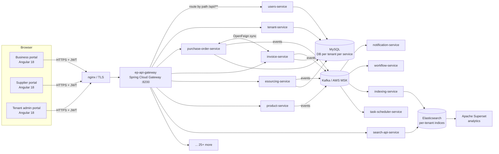

# 00: System overview

## What the product is
**eProcure** is a multi-tenant procurement platform. A **tenant** is a company using the platform. There are two main tenant types:
- **BUSINESS / CLIENT** (buyer): raises requisitions and POs, runs RFQs, receives invoices, pays.
- **SUPPLIER** (seller): publishes catalogs, answers RFQs, receives POs, sends invoices.

There is also a **tenant-portal** (platform admin) that onboards tenants and switches modules on or off.

## Architecture diagram

## Services (group them like this when asked)
| Group | Services |
|---|---|
| Edge | `ep-api-gateway` (Spring Cloud Gateway, reactive/WebFlux) |
| Platform | `ep-tenant-service`, `ep-users-service`, `ep-supplier-user-service`, `identity-management-lib` (IAM), `tmt-multitenancy` (lib), `application-essentials` (lib), `ep-master-data-service`, `ep-reference-data-shared-service`, `ep-translation-service` |
| Procurement domain | `ep-purchase-order-service`, `ep-invoice-service`, `ep-contract-service`, `ep-esourcing-service`, `ep-product-service`, `ep-supplier-service`, `ep-supplier-procurement-service`, `ep-spend-mgmt-service` |
| Operations (built 2026) | `ep-inventory-service`, `ep-manufacturing-service`, `ep-logistics-service`, `ep-operations-service` |
| Supporting | `ep-workflow-service`, `ep-notification-service`, `ep-task-scheduler-service`, `ep-document-management-service`, `ep-document-parsing-service`, `ep-ubl-service`, `ep-e-signing-service`, `ep-payment-gateway-service`, `ep-integration-service` |
| Search/analytics | `ep-indexing-service`, `ep-search-api-service`, `ep-analytics-service`, Apache Superset |

## Tech stack
- **Backend:** Java 8→11, Spring Boot 2.4.x, Spring Cloud Gateway, OpenFeign, Spring Data JPA/Hibernate, MySQL, Liquibase, Spring Kafka, Elasticsearch Java client, Javers (audit), JJWT, Lombok, springdoc OpenAPI, Gradle.
- **Messaging:** Kafka on AWS MSK (IAM auth via `aws-msk-iam-auth`).
- **Frontend:** Angular 18, PrimeNG 18, Bootstrap 5, RxJS 7, ngx-translate, a shared `identity-management-ui-lib`.
- **Infra:** Docker, AWS ECR, Jenkins → GitLab CI, nginx, docker-compose deploys.
- **Third parties:** Stripe, DocuSign, Superset, SMTP.

## Life of one request (say this fluently)
1. The Angular app calls `https://<tenant-domain>/api/purchase-order-service/po/123` with `Authorization: Bearer <JWT>`.
2. **nginx** terminates TLS and forwards to the **gateway**.
3. The gateway's `JwtAuthorizationFilter` (a `GlobalFilter`):
   - skips CORS preflight `OPTIONS`;
   - skips token checks for **whitelisted paths** (login, signup, OTP, public settings, Swagger), **internal Feign calls** (an `X-FEIGN-ID` header) and file downloads;
   - otherwise validates the JWT and **adds headers**: `X-TENANT-ID`, `X-TARGET-TENANT-QUALIFIER`, `X-USER-INFO`, `IAM-USER-INFO`, `X-DOMAIN`, `X-TENANT-TYPE`.
4. Route predicate `Path=/*/purchase-order-service/**` → forwards to the PO service.
5. In the PO service, Spring MVC **HandlerInterceptors** run:
   - `MultiTenancyRestRequestInterceptor` reads the tenant qualifier header and puts it in a **ThreadLocal** (`TenantContext`);
   - `UserInformationProviderInterceptor` reads the user JSON header into `IamContextHolder`;
   - `DefaultApiInterceptor` checks the **API-level ACL** (is this user allowed `GET /po/{id}`?).
6. The controller calls the service, and JPA opens a session. Hibernate asks `CurrentTenantIdentifierResolver` "which tenant?", which returns the qualifier, and `MultiTenantConnectionProvider` hands out that tenant's **Hikari pool**.
7. If other data is needed, a **Feign** client calls another service; the Feign interceptor copies the tenant headers across.
8. Domain events (e.g. "PO created") go to **Kafka** on a tenant-specific topic `ep.<tenant>.po-topic`.
9. `postHandle` clears the ThreadLocal.

## Q&A
**Q: Why microservices and not a monolith?**
A: Independent domains (PO, invoice, sourcing, catalog) with separate teams and release cycles; different scaling needs (search and indexing are heavier than tenant admin); failure isolation; and per-service databases made per-tenant isolation natural. The cost: distributed transactions, harder debugging, many deployables. We handled consistency with events and status fields rather than distributed transactions.

**Q: How do services talk?**
A: Synchronous **OpenFeign** when we need an answer right now (e.g. fetch supplier details while building a PO). Asynchronous **Kafka** for side effects and fan-out: notifications, indexing, workflow results, sending a PO to the supplier tenant. Rule of thumb: queries → Feign, "something happened" → Kafka.

**Q: How do you keep data consistent across services?**
A: Each service owns its data. Cross-service changes are **eventually consistent via events**, for example: workflow approves → `task-approved-rejected-topic` → the PO/invoice service updates its own status. No 2PC. Where it matters we keep a status field (PENDING_APPROVAL, APPROVED…) so the UI shows the in-between state. A proper fix for "DB write succeeded but Kafka publish failed" would be the **transactional outbox** pattern (see 03).

**Q: What's a shared-objects JAR?**
A: Each service publishes its DTOs/events/enums as a separate artifact (`*-shared-objects`) to Nexus. Consumers depend on that JAR, so producer and consumer share one contract. Downside: version coupling. Bumping an event means bumping every consumer.
