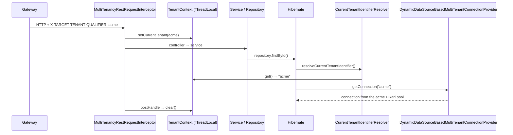

# 01: Multi-tenancy (database per tenant, per service)

## What it does
Every tenant (company) gets its **own MySQL database for each service**, e.g. `acme_purchase_order`, `acme_invoice`. One running instance of the PO service serves all tenants and picks the right database **per request**.

All of this lives in a shared library, **`tmt-multitenancy`**, enabled with `@EnableMultitenancy`, so every service gets it for free.

## The three tenancy models (expect this question)
| Model | Isolation | Cost | Used by us? |
|---|---|---|---|
| Shared DB, shared schema + `tenant_id` column | Weakest (one missed `WHERE` leaks data) | Cheapest | No |
| Shared DB, schema per tenant | Medium | Medium | No |
| **Database per tenant** | **Strongest**; easy per-tenant backup/restore/delete | Most connections, harder migrations | **Yes** |

Why we chose it: B2B customers (some public-sector) wanted hard data isolation, and per-tenant delete/backup was a requirement.

## Architecture

## Low-level parts

### 1. Tenant context
- `TenantContext` holds two `InheritableThreadLocal<Tenant>` values: **CURRENT_TENANT** (whose data we touch) and **SOURCE_TENANT** (who triggered it; used for cross-tenant flows such as buyer → supplier).
- It's wrapped by `TenantSessionService` (set/get/clear), so code never touches the ThreadLocal directly.

### 2. Setting the tenant: three entry points
| Entry | Class | Reads |
|---|---|---|
| HTTP | `MultiTenancyRestRequestInterceptor` (Spring `HandlerInterceptor`) | `X-TARGET-TENANT-QUALIFIER` header; returns **400** if it's missing |
| Kafka consumer | `MultiTenancyKafkaConsumerInterceptor` (Kafka `ConsumerInterceptor`) | `X-TARGET-TENANT-QUALIFIER` **record header**; throws `TenantIdMissingException` if it's missing |
| `@Async` threads | `TenantAwareTaskDecorator` (Spring `TaskDecorator`) | Captures the tenant on the caller thread and sets it on the worker thread, with `finally clear()` |

And it **propagates outward**:
- `MultiTenancyFeignClientInterceptor` copies the tenant headers onto every Feign call.
- `MultiTenancyKafkaProducerInterceptor` adds `X-SOURCE-TENANT-QUALIFIER` to every produced record.

### 3. Picking the database (Hibernate multi-tenancy, `DATABASE` strategy)
- `CurrentTenantIdentifierResolverImpl.resolveCurrentTenantIdentifier()` returns the qualifier from the context, or `"BOOTSTRAP"` when there's none (startup, health checks).
- `DynamicDataSourceBasedMultiTenantConnectionProvider` extends Hibernate's `AbstractDataSourceBasedMultiTenantConnectionProviderImpl`:
  - `ConcurrentHashMap<String, DataSource>` maps qualifier → **HikariDataSource** (pool named `acme-DataSourcePool`);
  - `selectDataSource(tenantId)` → map lookup; `selectAnyDataSource()` → default datasource.
  - In `@PostConstruct load()` it asks **tenant-service** (Feign: `getTenantDbConfiguration("applicationName:<this service>")`) for every tenant's JDBC URL/user/password **for this service only**, and builds one pool each.
- `TenantPersistenceConfig` wires the resolver and provider into the `EntityManagerFactory` (`hibernate.multiTenancy=DATABASE`).

### 4. Tenant metadata cache
- `TenantCacheUtils`: a static `ConcurrentHashMap<Long, TenantConfigurationData>` of all tenants (domain, name, type, settings) loaded from tenant-service, refreshed every 5 minutes by `@Scheduled(fixedDelay = 300000)`. Used for "what's this tenant's domain/name" without a network call.

### 5. Schema migrations per tenant
- `DynamicDataSourceBasedMultiTenantSpringLiquibase` runs on startup: for **each tenant datasource** it builds a `SpringLiquibase` and runs the same changelog, passing `tenant_qualifier` as a changelog parameter. One failing tenant is logged and the others continue. See [12](12-liquibase-audit-scheduler.md).

## Weak spots and how I'd improve them (great "what would you change?" answers)
1. **The ThreadLocal is cleared in `postHandle`, not `afterCompletion`.** `postHandle` is **skipped when the controller throws**, so on errors the tenant stays on that Tomcat thread, and the next request on that thread could start with the wrong tenant. Fix: clear in `afterCompletion` (always runs), or use a servlet `Filter` with `try/finally`.
2. **`InheritableThreadLocal` with thread pools** is risky: pooled threads are created once and keep the value inherited at creation. Explicit `TaskDecorator` propagation (which we also do) is the right approach. Remove the inheritable part.
3. **New tenants need a restart** for pools and listeners: datasources load in `@PostConstruct`. We literally restarted containers after onboarding. Fix: lazily create the pool on first miss (`computeIfAbsent`), or listen to a `tenant-created` event and register pools and Kafka listeners at runtime.
4. **Connection count**: N tenants × M services × pool size. With 50 tenants × 30 services × 10 = 15,000 connections. Fix: small `maximumPoolSize` per tenant, idle timeouts, or a proxy like ProxySQL; or move small tenants to schema-per-tenant.
5. Tenant DB passwords travel over a REST call. They should come from a secrets manager (AWS Secrets Manager/Vault).

## Interview Q&A

**Q: How does your service know which tenant a request belongs to?**
A: The gateway takes the tenant from the validated JWT (or from the Host header for public pages) and sets `X-TARGET-TENANT-QUALIFIER`. Each service has a HandlerInterceptor that puts it into a ThreadLocal tenant context. Hibernate's `CurrentTenantIdentifierResolver` reads that context, and our `MultiTenantConnectionProvider` returns a connection from that tenant's Hikari pool.

**Q: Why not just add `tenant_id` to every table?**
A: Isolation and operations. With DB-per-tenant a missing WHERE clause can't leak data, and we can back up, restore, move or delete one tenant independently. The trade-off is more connections and running migrations N times.

**Q: What happens with `@Async` or `CompletableFuture`?**
A: A new thread doesn't have the ThreadLocal. We registered a `TaskDecorator` on the async executor that captures the tenant from the calling thread and sets it in the worker, clearing it in `finally`. For a raw `CompletableFuture.supplyAsync` without our executor you'd lose it, so we always pass our executor.

**Q: How does Kafka know the tenant?**
A: Producers add a tenant header to the record, and topics themselves are tenant-specific (`ep.<tenant>.<topic>`). The consumer interceptor reads the header and sets the context before the listener runs. See [03](03-kafka-events.md).

**Q: How do you run DB migrations for 50 tenants?**
A: On startup, Liquibase runs the same changelog against every tenant datasource in a loop. It's idempotent thanks to the `DATABASECHANGELOG` table. One failing tenant doesn't block the others but gets logged. Improvement: run migrations as a separate job before deploying, not on app startup.

**Q: What is a "BOOTSTRAP" tenant?**
A: The fallback identifier when no tenant is in context (app startup, scheduled jobs before they set a tenant). It maps to the default datasource.

**Q: How would you make onboarding a tenant not need a restart?**
A: Publish `tenant-created` on Kafka; each service's listener creates the Hikari pool (`computeIfAbsent`), runs Liquibase for just that tenant, and registers its tenant-specific Kafka listener containers at runtime through `KafkaListenerEndpointRegistry`.

**Q: How do you test tenant isolation?**
A: Integration tests with two tenants (Testcontainers MySQL): create data as tenant A, query as tenant B, and assert it's empty. Also a test where the controller throws, to check the next request doesn't reuse the tenant (catches the `postHandle` bug).
