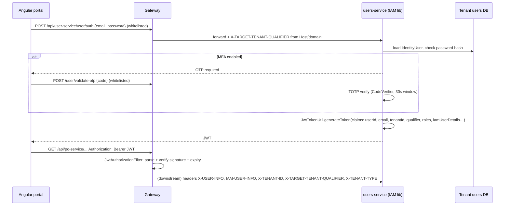
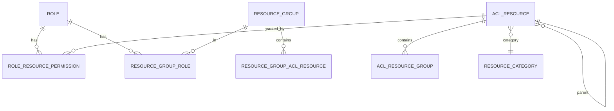

# 02: API Gateway, JWT authentication, IAM, ACL authorization, MFA

## Pieces
| Piece | Where | Job |
|---|---|---|
| **API Gateway** | `ep-api-gateway` (Spring Cloud Gateway, reactive Netty/WebFlux) | Single entry, routing, JWT validation, header enrichment, CORS |
| **IAM library** | `identity-management-lib` | Users, login, JWT generation, roles, ACL resources, MFA (TOTP), access logs |
| **Authorization** | `application-essentials` → `DefaultApiInterceptor` | Per-API permission check in every service |
| **Users service** | `ep-users-service` (+ `ep-supplier-user-service`) | Hosts the IAM endpoints (`/user/auth`, `/auth/users/my-acls`), seeds ACL data |
| **UI library** | `identity-management-ui-lib` (Angular) | Shared login/OTP/user-management screens |

## Authentication flow

### Gateway filter details (`JwtAuthorizationFilter implements GlobalFilter`)
1. `OPTIONS` (CORS preflight) → pass through; `CorsWebFilter` handles it.
2. Work out whether the token must be checked:
   `shouldValidate = !isFeignCall && !isDownload && !isWhitelisted`
   - **Whitelist**: Ant patterns from config (`/user/auth`, `/user/signup`, `/user/validate-otp`, `/v3/api-docs/**`, the DocuSign callback, the Shopify webhook…) **plus** path + query-param combinations (e.g. `/translation?translationKey=login_page` so the login page can load its labels).
3. If validating: `AuthenticationService.getAuthenticationInfo(token)` parses claims (JJWT, HMAC secret), resolves **tenant type** from the cached tenant list, and **mutates the request** to add the headers above.
4. If not validating (a public call): resolve the tenant from an explicit `X-TARGET-TENANT-QUALIFIER` header or from the **Host header → tenant domain cache**, and add a "system" user header.
5. Any parse failure → `ApiGatewayException(INVALID_TOKEN)` → a JSON 401 through a custom `ErrorWebExceptionHandler`.

Routing lives in `bootstrap.yml`: `Path=/*/purchase-order-service/**` → `http://po-service:port`, with a `StripPrefix` filter.

## Authorization: the ACL model

- **AclResource**: a permission node, hierarchical (`parent`, `isLeaf`), e.g. `purchase_order` → `purchase_order.create`. It has a `resourceType` (MENU/FUNCTION/API…), a `displayName` and a category.
- **Role** (`roleCode`, `roleType`) ↔ many AclResources directly, or through **ResourceGroups** (bundles like "PO full access").
- **API permissions** map `(HTTP method, URI template)` → required ACL + a rule (ALLOW / DENY / PRIVILEGED).

### Enforcement: `DefaultApiInterceptor.preHandle` in every service
1. Skip internal Feign calls (`X-FEIGN-ID`).
2. If `apiAuthorizationCheckEnabled=false` → allow.
3. Turn the actual URI back into its **template**: `/po/123` → `/po/{id}`, using `URI_TEMPLATE_VARIABLES_ATTRIBUTE`. That's how one rule covers every ID.
4. Skip exclusion patterns.
5. Look up the `ApiPermission` for (template, method):
   - none found → **RESTRICTIVE** mode denies, **PERMISSIVE** mode allows (production ran PERMISSIVE by default);
   - ALLOW → allow; DENY → 403;
   - PRIVILEGED → super-admin role codes bypass; otherwise check the user's ACLs.
6. User ACLs come from `GET /api/user-service/auth/users/my-acls` (in 2026 I re-pointed every service to the unified user-service) and are cached per session.

Seeding: ACLs are inserted with **Liquibase DML changelogs** (I wrote ~2,700 lines for the inventory/manufacturing/logistics/operations modules: module-function ACLs + default role ACLs), so a new module works for existing roles on day one.

### MFA
TOTP via the `dev.samstevens.totp` library (`MfaConfiguration`): `DefaultSecretGenerator` makes the per-user secret, `ZxingPngQrGenerator` renders the QR for Google/Microsoft Authenticator, and `DefaultCodeVerifier` with `SystemTimeProvider` checks the 6-digit code (30 s steps, small drift window). The frontend shows `ng-otp-input`; "disable MFA" requires a valid OTP.

### Access logging
`LoggingInterceptor` and `AccessLogService` record request metadata (user, path, IP, timing) to an `access_log` table for audit.

## Weak spots and how I'd improve them
1. **Trusting `X-FEIGN-ID` from outside.** The gateway skips JWT validation if the header is present, and services skip ACLs for it. An external caller could send that header. Fix: the gateway should **strip** internal headers from incoming requests; service-to-service calls should use mTLS or a signed service token (OAuth2 client credentials).
2. **Downstream services trust the `X-USER-INFO` JSON header** without re-verifying. That's fine only if services can't be reached except through the gateway (network policy). Better: forward the JWT itself and verify it in each service (cheap with HMAC/RSA).
3. **Symmetric HMAC secret shared by all services.** If any service leaks it, tokens can be forged. Fix: RS256, where only IAM holds the private key and everyone else verifies with the public key (JWKS).
4. **GET requests containing "download" skip auth.** Too broad. Fix: signed, expiring download URLs (e.g. S3 presigned).
5. **PERMISSIVE default.** An unregistered API is open. Production should be RESTRICTIVE, with a CI check that every controller mapping has a permission row.
6. CORS `allowed-origins: *` with `allow-credentials: true`. Browsers reject that combination for credentialed requests, and it's too open anyway. Use an explicit allow-list of tenant domains.

## Interview Q&A

**Q: Where is authentication done, and where is authorization done?**
A: Authentication is **centralised in the gateway** (validate the JWT once). Authorization is **distributed**: each service checks API-level ACLs in a HandlerInterceptor, because only the service knows its endpoints, and data-level rules (e.g. "only the PO's buyer") live in service code.

**Q: What's inside your JWT?**
A: Subject (email), user ID, tenant ID and qualifier, platform/ownership type, IAM user details (roles), issued-at and expiry. Never passwords or ACL lists (too big). ACLs are fetched separately and cached.

**Q: How do you handle token expiry?**
A: Short-lived access token plus refresh. On the Inclufy side I fixed a bug where the UI logged people out when the shortest-lived per-tenant token expired. Now it refreshes the main token first, re-mints the per-tenant tokens, and only logs out when refresh is rejected (see [14](14-inclufy-sso.md)).

**Q: How do you revoke a JWT before expiry?**
A: JWTs are stateless, so you need extra state: a denylist of token IDs (`jti`) in Redis checked at the gateway, or a per-user "tokens issued before X are invalid" timestamp. Plus short lifetimes.

**Q: Spring Cloud Gateway vs Zuul?**
A: Gateway is reactive (Netty, WebFlux), non-blocking, and supports filters and predicates natively. Zuul 1 is blocking servlet-based and in maintenance. Because the gateway is reactive, you must **not block** in a GlobalFilter (no JDBC calls), which is why tenant lookups come from an in-memory cache.

**Q: How does `/po/123` match a permission?**
A: Spring stores the path variables for the matched handler. We replace each value with `{name}` to get `/po/{id}`, then look up (template, method). So one rule covers all IDs and we don't need regexes.

**Q: How would you add a new role?**
A: Create the Role, attach ResourceGroups (bundles of ACLs), assign it to users. No code change, because permissions are data. New *functions* need new AclResource rows, which we seed with Liquibase.

**Q: How does TOTP work?**
A: Server and authenticator app share a secret (through the QR code). Both compute `HMAC-SHA1(secret, floor(unixTime/30))`, truncated to 6 digits. The server accepts the current window ±1 for clock drift. No SMS, works offline.

**Q: How do you protect login from brute force?**
A: Rate-limit at the gateway/nginx per IP and per account, lock out after N failures, MFA, and generic error messages ("invalid credentials" whether or not the email exists).
