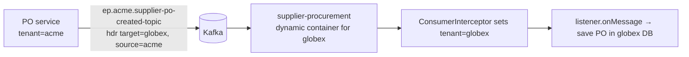

# 03: Kafka event-driven architecture

## What it does
Services publish "something happened" events. Other services react. That gives loose coupling, fan-out (one event → many consumers) and retries without the caller waiting. We ran Kafka on **AWS MSK** with IAM auth.

## Topic naming: tenant-specific topics
```
<prefix>.<tenantQualifier>.<topic>      e.g.  ep.acme.po-topic
<prefix>.<topic>                        e.g.  ep.send-templated-email-topic   (shared/global topics)
```
- `prefix` (`TOPIC_PREFIX`, default `ep`) separates environments (dev/sit/uat/prod) on a shared cluster.
- Topic names live in `application.yml` under `kafka.custom.topic.producers` / `consumers` and bind to `TopicConfiguration` (`@ConfigurationProperties(prefix="kafka.custom.topic")`).

## Event map (main flows)
| Topic | Producer | Consumers | Meaning |
|---|---|---|---|
| `por-created-topic` | PO service | workflow / notification | Requisition raised |
| `task-approved-rejected-topic` | **workflow** | PO, invoice, contract, eSourcing | An approver acted; `isWorkflowCompleted` flag |
| `supplier-po-created-topic` / `po-topic` | PO service | **supplier**-procurement service (supplier tenant) | Buyer's PO lands at the supplier |
| `supplier-invoice-created-topic` | supplier side | invoice service (buyer tenant) | Supplier invoiced the buyer |
| `po-payment-received-topic`, `invoice-payment-received-topic`, `payment-update-topic` | payment-gateway | PO, invoice, contract | Payment status |
| `rfq/rfp/rfi-*-topic` (approved, closed, evaluated, status-changed, response-submitted, clarification-event) | eSourcing / supplier-procurement | each other, contract, notification | Sourcing lifecycle |
| `task-scheduler-submit-topic` → `schedule-executed-topic` | eSourcing, contract → **task-scheduler** → back | | Fire at a time (e.g. RFQ closing) |
| `sign-complete-topic`, `sign-decline-topic`, `re-initiate-sign-topic` | e-signing | contract | DocuSign outcomes |
| `product-index-topic`, `catalog-products-index-topic`, `product-category-index-topic`, `product-brand-index-topic` | product / supplier | **indexing** | Re-index in Elasticsearch |
| `send-templated-email-topic`, `send-simple-email-topic`, `send-simple-sms-topic` | everyone | **notification** | Send messages |
| `stock-checked-in-topic`, `auto-reorder-topic` | inventory (2026) | PO / supplier procurement | Stock-in; auto reorder below threshold |

## Producing: `MultiTenantKafkaEventProducer`
```java
// for each target tenant (e.g. buyer → several suppliers)
topic  = prefix + "." + tenant.qualifier + "." + topicName;
record = new ProducerRecord(topic, event);
record.headers().add("X-TARGET-TENANT-QUALIFIER", tenant.qualifier);
kafkaTemplate.send(record);
```
- A `TenantAwareKafkaEvent` carries **a list of target tenants**, which is how one buyer action reaches many supplier tenants (e.g. publishing an RFQ to 5 suppliers).
- `MultiTenancyKafkaProducerInterceptor.onSend` adds `X-SOURCE-TENANT-QUALIFIER` (the current tenant) so the consumer knows **who sent it**.
- Serialisation: Spring Kafka `JsonSerializer`; events implement `BaseKafkaEvent` and ship in shared-objects JARs.

## Consuming: two styles

### a) Static `@KafkaListener` (single-tenant/global topics)
e.g. the task scheduler: `@KafkaListener(topics = "${prefix}.${task-scheduler-submit-topic}", groupId=..., containerFactory=...)`.

### b) Dynamic per-tenant listeners: `CustomKafkaListenerRegistrar`
Because topics are per tenant, you can't hard-code them in annotations. Instead:
1. A service implements `TenantAwareKafkaListener<T>` (`getTopicName()`, `onMessage(T)`, `getDeserializer()`), e.g. `ProductIndexEventListener`.
2. At startup (`InitializingBean.afterPropertiesSet`) the registrar:
   - loads every tenant that uses this service (from tenant-service);
   - for each configured consumer topic × each tenant, builds `prefix.tenant.topic`;
   - creates a `ConcurrentMessageListenerContainer` with `ContainerProperties(topicName)` and a `MessageListener` that deserialises and calls `listener.onMessage(...)`, then starts it.
3. `MultiTenancyKafkaConsumerInterceptor.onConsume` reads `X-TARGET-TENANT-QUALIFIER` from the record headers and sets the tenant context **before** the listener runs, so the JPA calls inside hit the right database.



## Reliability details (what we had / what to say)
- **Consumer groups**: one group per service, so each service gets every event once and its instances share partitions.
- **Ordering**: only per partition. Key events by entity ID (e.g. PO number) so all events for one PO stay in order.
- **Delivery**: at-least-once (auto-commit/after processing). **Consumers must be idempotent**: check current status before applying a transition (e.g. ignore "approved" when the PO is already APPROVED).
- **Errors**: listeners mostly logged and swallowed exceptions (e.g. the indexing listener). Spring Kafka's `DefaultErrorHandler` with `DeadLetterPublishingRecoverer` would be better: retry with backoff, then park the message in `<topic>.DLT`.

## Weak spots and how I'd improve them
1. **Dual-write problem**: services save to MySQL and then `kafkaTemplate.send()`. If the app dies in between, the event is lost (or sent for a rolled-back transaction). Fix: **transactional outbox**. Write the event into an `outbox` table in the same DB transaction, and have a poller or Debezium CDC publish it.
2. **Topic explosion**: topics × tenants. 60 topics × 100 tenants = 6,000 topics, plus partition overhead. Alternative: shared topics keyed by tenant, with the tenant in a header (which we already send). Per-tenant topics only for very large tenants.
3. **New tenant = restart** to register listener containers. Fix: listen to `tenant-created` and register containers at runtime.
4. **Bug spotted**: the consumer interceptor set the *source* tenant from the *target* header. A small bug, but a good "I found this during code review" story.
5. **Schema evolution**: JSON plus shared JARs means version lockstep. A Schema Registry (Avro/Protobuf) with backward-compatibility rules lets consumers upgrade independently.
6. No **DLT/retry** policy and silent swallowing. Add a DLT and alert on DLT lag.

## Interview Q&A

**Q: Why Kafka and not REST for these flows?**
A: The producer shouldn't wait or fail because notifications, search indexing or the supplier tenant are slow or down. Kafka buffers durably, lets many consumers subscribe (notification + indexing + workflow), and consumers can replay. REST is for "I need an answer now."

**Q: Why Kafka and not RabbitMQ?**
A: Durable log with replay, high throughput, partitions for scale, consumer groups. RabbitMQ is great for task queues and routing; the workflow service actually had AMQP wiring too. For event streams many consumers read independently, Kafka fits better.

**Q: Explain partitions and consumer groups.**
A: A topic is split into partitions, each an ordered log. In a consumer group each partition is read by exactly one consumer, so max parallelism = partition count. Different groups each get all messages. Adding a consumer triggers a **rebalance** that redistributes partitions.

**Q: How do you guarantee ordering?**
A: Only within a partition, so use a stable key (entity ID) so all events of one entity go to the same partition. With retries enabled, set `max.in.flight.requests.per.connection ≤ 5` with `enable.idempotence=true` to keep order.

**Q: At-least-once vs exactly-once?**
A: At-least-once means you may get duplicates, so make consumers idempotent (check status, unique constraint on event ID, processed-events table). Exactly-once in Kafka needs an idempotent producer plus transactions (`read_committed`), and only covers Kafka-to-Kafka. Once you write to an external DB you still need idempotency.

**Q: What happens if a consumer throws?**
A: With Spring Kafka's default error handler it retries (default 10 attempts, no backoff in older versions), then logs and skips. We should configure `DefaultErrorHandler(new DeadLetterPublishingRecoverer(template), new FixedBackOff(1000, 3))` so poison messages go to a DLT instead of blocking the partition.

**Q: How does a consumer know which tenant's DB to use?**
A: The producer puts `X-TARGET-TENANT-QUALIFIER` in the record headers (and in the topic name). A Kafka `ConsumerInterceptor` reads it and sets our ThreadLocal tenant context before the listener method runs.

**Q: What is the transactional outbox?**
A: Instead of DB write + Kafka send (two systems, no atomicity), write the business row **and** an outbox row in one local transaction. A separate relay (poller or Debezium CDC on the binlog) publishes outbox rows to Kafka and marks them sent. Delivery is at-least-once, so consumers stay idempotent.

**Q: What is a Saga, and where would it apply?**
A: A long business transaction split into local steps, each with a compensating action, coordinated by events (choreography) or an orchestrator. Example: PO approved → reserve budget → send to supplier. If the supplier rejects, compensate by releasing the budget and marking the PO cancelled. Our approval flow is a simple choreographed saga.

**Q: How did you configure MSK auth?**
A: The `aws-msk-iam-auth` library: `security.protocol=SASL_SSL`, `sasl.mechanism=AWS_MSK_IAM`, `sasl.jaas.config=software.amazon.msk.auth.iam.IAMLoginModule required;` and `sasl.client.callback.handler.class=...IAMClientCallbackHandler`. Permissions come from the task/instance IAM role, so there are no passwords in config.
