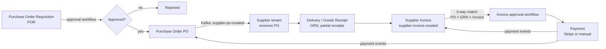

# 04: Procure-to-Pay (P2P): requisition → PO → goods receipt → invoice → payment

## Business flow (learn this; domain questions are common)

**Terms you must know:** requisition (an internal request to buy), PO (a legal order to a supplier), GRN (goods received note), **three-way match** (PO qty/price = received qty = invoiced qty/price before paying), catalog vs **non-product items (NPI)** (free-text lines), punch-out/catalog, cost centre, GL account, budget.

## Services involved
| Step | Service | Notes |
|---|---|---|
| Catalog / products | `ep-product-service`, supplier catalog via `ep-supplier-procurement-service` | Products indexed into Elasticsearch for the marketplace search |
| POR + PO | `ep-purchase-order-service` | Statuses below; also XML generation (`PurchaseOrderXmlGenerationStatus`) for e-procurement standards |
| Approvals | `ep-workflow-service` | Serial/parallel approvers (see [05](05-workflow-engine.md)) |
| Supplier side | `ep-supplier-procurement-service` | PO received, stock check-in, barcode scan, auto-reorder, invoice status tracker (2026 work) |
| Invoice | `ep-invoice-service` | Buyer invoices, external invoice parsing (`ep-document-parsing-service`), UBL conversion (`ep-ubl-service`) |
| Payment | `ep-payment-gateway-service` | Stripe Checkout; manual payments (see [08](08-payments-stripe.md)) |

## Status machines (from the code)
- **PORequisitionStatus:** `DRAFT → PENDING_REVIEW → REVIEWED → PENDING_APPROVAL → APPROVED | PARTIALLY_APPROVED | REJECTED`
- **PORequisitionItemStatus:** `PENDING_APPROVAL | APPROVED | REJECTED | NONE`, so **line-level** approval is possible, which is why PARTIALLY_APPROVED exists.
- **PurchaseOrderStatus:** `APPROVED → WAITING_DELIVERY → PARTIALLY_RECEIVED → RECEIVED`
- **PoPaymentStatus:** `UNPAID → PARTIALLY_PAID → PAID`

## Key flows in detail

### 1. Requisition → approval
1. The user builds a POR (catalog items and/or non-product items, delivery address, cost centre). Saved as DRAFT.
2. Submit: the PO service calls the workflow service (Feign `startSimpleWorkflow`/`startParallelWorkflow`) with approvers worked out from tenant settings (amount thresholds / department). Approver emails go out via the notification topic.
3. Each approval produces `task-approved-rejected-topic` with `isWorkflowCompleted`. The PO service's listener updates the item/POR status; when complete and APPROVED it **creates the PO(s)**, one per supplier (a POR with items from 3 suppliers → 3 POs).

### 2. PO → supplier tenant (cross-tenant)
- The PO service publishes `supplier-po-created-topic` with **target tenant = supplier's qualifier** and source = buyer. The supplier's procurement service consumes it in the supplier's DB. Both sides keep their own copy; later status updates go back the other way by events.
- Edge case I fixed: an internal supplier and a registered supplier can have **the same supplier ID** (different ID spaces), so we matched the saved supplier on PO by **ID + name**.

### 3. Goods receipt
- The supplier ships; the buyer records receipts per line. Partial receipts → `PARTIALLY_RECEIVED`. In 2026 we added warehouse **stock check-in** with barcode scanning on the supplier/inventory side, publishing `stock-checked-in-topic`; `auto-reorder-topic` raises a reorder when stock falls below the minimum.

### 4. Invoice
- The supplier creates an invoice against the PO → `supplier-invoice-created-topic` to the buyer tenant.
- External PDF invoices: uploaded → `ep-document-parsing-service` extracts fields → `ext-invoice-parsing-completed-topic` → invoice service creates a draft. `invoice-ubl-conversion-completed-topic` → UBL XML (the European e-invoicing standard).
- Invoice approval workflow → payment.

### 5. Payment
- Stripe Checkout or manual payment → `po-payment-received-topic` / `invoice-payment-received-topic` → PO payment status and invoice status update. I fixed the payment-intent and redirect flow in 2026.

### Marketplace (my 2024 work)
- Public-tenant marketplace checkout: **discounted price** shown on the product view and calculated from the indexed discount percentage; **coupons** at checkout (with ACLs for coupon management); checkout quantity rules for in-stock vs out-of-stock items; discount carried into the POR.

## Weak spots and how I'd improve them
- Creating POs after approval and sending to the supplier are separate steps with no outbox, so a crash can leave an approved POR without a PO. Fix: an outbox plus an idempotent "create PO for POR" (unique constraint on POR ID + supplier).
- Three-way match tolerance rules (± price %) should be configurable per tenant.
- Money is `BigDecimal` (good). Make sure every rounding uses `RoundingMode.HALF_EVEN` and currency scale.

## Interview Q&A

**Q: Walk me through your procure-to-pay flow.**
A: (Use the diagram.) Requisition → approval workflow → one PO per supplier → event to the supplier's tenant → goods receipt (partial allowed) → supplier invoice event back to the buyer → three-way match and invoice approval → payment through Stripe or manual → payment events update PO and invoice status.

**Q: How do you handle partial approval?**
A: Approval status exists at line-item level. If some lines are rejected the POR becomes PARTIALLY_APPROVED and POs are created only for approved lines.

**Q: How does a PO from tenant A reach supplier tenant B safely?**
A: Never by direct DB access. The buyer's service publishes an event to B's tenant topic with B as the target and A as the source header. B's service consumes it into B's own database. Each tenant only ever writes its own DB.

**Q: How do you make sure a PO isn't created twice if the approval event is delivered twice?**
A: Idempotent consumer: before creating, check the POR status (already PO_CREATED → ignore), plus a unique DB constraint on (por_id, supplier_id). Kafka is at-least-once, so we design for duplicates.

**Q: What's a three-way match?**
A: Before paying, compare the PO (what we ordered, at what price), the GRN (what actually arrived) and the invoice (what we're billed). Pay only if they agree within tolerance; otherwise route to an exception workflow.

**Q: How do you store money?**
A: `BigDecimal` in Java and `DECIMAL(19,4)` in MySQL, never double. Stripe wants the minor unit (cents), so `amount × 100 → long`.

**Q: How did you design the stock / auto-reorder feature?**
A: Check-in updates stock per warehouse/bin/lot and publishes `stock-checked-in-topic`. If quantity drops below the configured reorder level, the inventory service publishes `auto-reorder-topic`, and procurement creates a draft requisition for the preferred supplier. All async, so scanning stays fast.
