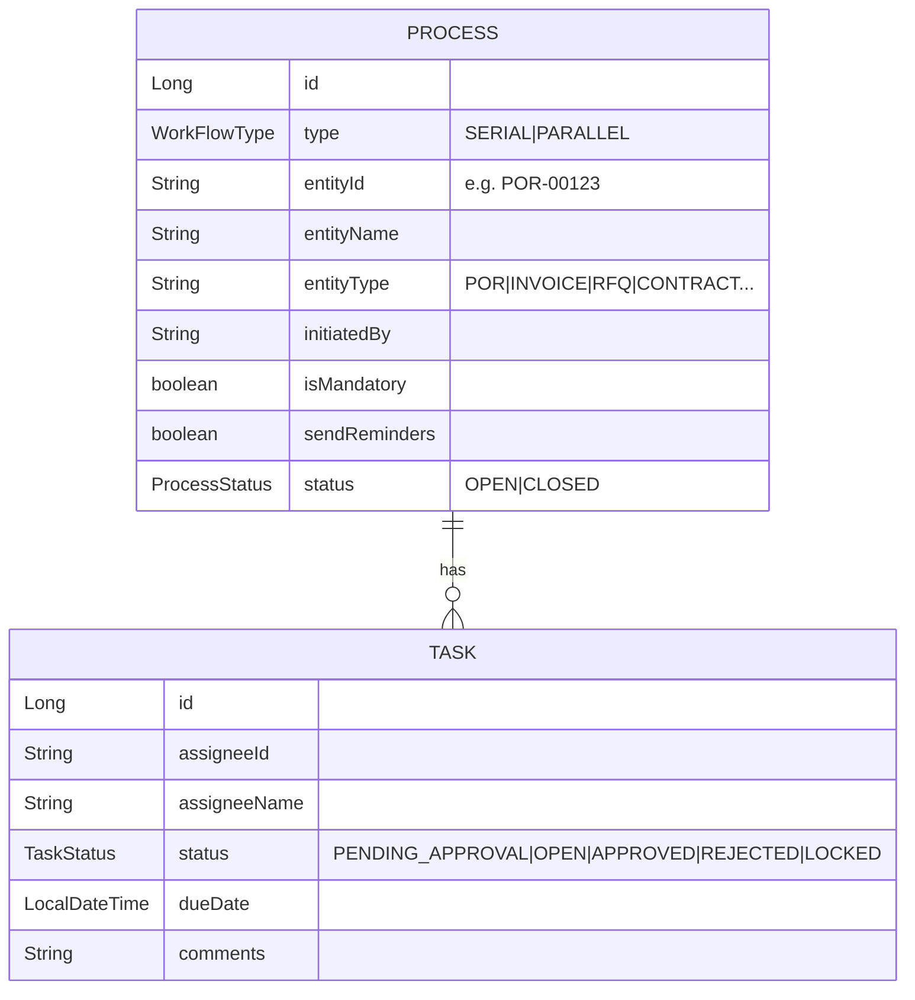

# 05: Workflow / approval engine (`ep-workflow-service`)

## What it does
A **home-grown** approval engine (no Camunda/Flowable) used by POR, PO, invoice, contract, RFI/RFP/RFQ and corrigendum approvals.
Two modes:
- **SERIAL**: approvers act one after another (manager → finance → director).
- **PARALLEL**: all approvers get the task at once.

Plus flags: `isMandatory` (all must approve vs any one is enough) and `sendReminders`.

## Data model

A trick in the model: the **process creates one extra "entity task"** assigned to the entity itself (`assigneeId = entityId`, status `PENDING_APPROVAL`). That task holds the **overall outcome**. Approver tasks are the others.

## Flow
```mermaid
sequenceDiagram
  participant PO as PO service
  participant WF as Workflow service
  participant N as Notification (Kafka)
  participant A as Approver (UI)
  PO->>WF: POST startSimpleWorkflow {entityId, approvers[], isMandatory}
  WF->>WF: save Process(OPEN) + entity task + approver tasks
  WF->>N: send-templated-email per approver (task link, attachments)
  A->>WF: GET my tasks (status OPEN; LOCKED if another approver acquired it)
  A->>WF: POST updateWorkflow {taskId, APPROVE|REJECT, comment}
  WF->>WF: task.status = APPROVED/REJECTED
  WF->>WF: if approved+rejected+1 == total → entity task = (any rejected ? REJECTED : APPROVED), process CLOSED
  WF->>PO: Kafka task-approved-rejected-topic {task, isWorkflowCompleted}
  PO->>PO: update POR status; if final APPROVED → create POs
```

### Completion rule (`WorkflowUtil.updateTask`)
```
approved = count(APPROVED), rejected = count(REJECTED)
if entityTask exists AND approved + rejected + 1 == allTasks:
    entityTask.status = rejected > 0 ? REJECTED : APPROVED
    process.status = CLOSED
publish TaskApprovedRejectEvent(task, isWorkflowCompleted)
```
- `closeWorkflow` handles early termination: a REJECT closes immediately; otherwise it goes to the mandatory/optional close logic.
- `getUserTasks` marks a task **LOCKED** when another approver has already picked it (stops double handling in parallel flows).
- Emails: one templated email per approver with the portal URL (tenant domain from `TenantCacheUtils`), the task ID and document attachments.

## Who decides the approvers?
The **calling service**, from tenant settings (e.g. approval matrix by amount/department; PO approver emails were validated against the tenant's allowed approver emails, which was one of my tickets, EP-2818). The workflow service only executes.

## Weak spots and how I'd improve them
1. **Race condition** in parallel approval: two approvers approve at the same moment, both read counts before the other commits, and neither (or both) closes the process. Fix: `@Version` optimistic locking on Process, or `SELECT … FOR UPDATE` on the process row inside the transaction.
2. Counting in Java after `findByProcess_Id` is fine at small scale; a single aggregate query is cleaner.
3. `Optional.get()` without checks → `NoSuchElementException` (a 500) for a bad task ID. Validate and return a 404.
4. No real **SLA/escalation** engine: `dueDate = now()`. Add an escalation job (the task scheduler can fire "remind/escalate after 48h").
5. For complex rules (conditional branches, delegation, out-of-office) a BPMN engine like **Camunda/Flowable** would be better. The trade-off: heavier, but you get visual modelling.

## Interview Q&A

**Q: Why build your own instead of Camunda?**
A: Our needs were simple (serial/parallel, mandatory/optional, emails, an event when done) and we wanted it multi-tenant out of the box with our DB-per-tenant library. Camunda adds its own schema, engine and learning curve. I'd switch if we needed conditional routing, timers, delegation or visual process design.

**Q: Serial vs parallel: how is it implemented?**
A: Same model, different `WorkFlowType`. `SimpleWorkflowUtil` (serial) and `ParallelWorkflowUtil` extend a common `WorkflowUtil` (Template Method pattern). `WorkFlowService.updateWorkflow` dispatches on the process type (Strategy-like).

**Q: How does the requesting service learn the result?**
A: Asynchronously: the workflow service publishes `task-approved-rejected-topic` with `isWorkflowCompleted`. The PO/invoice/eSourcing listener checks the entity type/ID and updates its own status. The workflow service doesn't know anything about POs, so it's decoupled.

**Q: Two approvers click approve at the same time. What happens?**
A: Without locking there's a lost-update risk on the process outcome. I'd add `@Version` on Process (optimistic lock) and retry on `OptimisticLockException`, or lock the process row (`PESSIMISTIC_WRITE`) during the update.

**Q: How would you add "approve if amount > 10k needs a director"?**
A: Keep rules in the calling service or a rules table: an approval matrix (entityType, minAmount, maxAmount, role). Resolve the approver list before starting the workflow. The engine stays generic.

**Q: Which design patterns are visible here?**
A: Template Method (`WorkflowUtil` base), Strategy (serial vs parallel), Observer/pub-sub (Kafka result events), DTO/Transformer (mapping).
