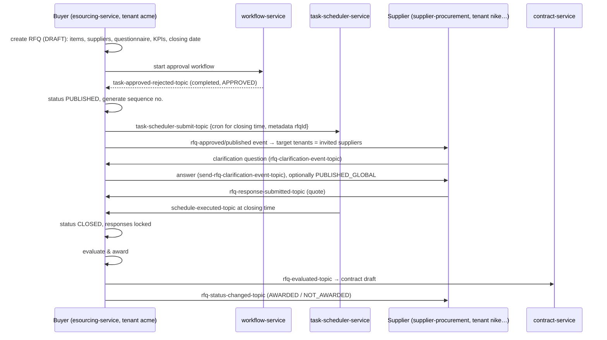

# 06: eSourcing: RFI / RFP / RFQ

## Business meaning
| Type | Purpose | Supplier returns |
|---|---|---|
| **RFI**: Request for Information | Learn about the market / qualify suppliers | Answers to a questionnaire |
| **RFP**: Request for Proposal | Solution + approach + price, judged on several criteria | Proposal + scores (KPIs) |
| **RFQ**: Request for Quotation | Price for a clearly specified item | Line-item quotes → award → PO / contract |

Other words: **corrigendum** (an official change to a published RFx, needs approval), **clarification** (Q&A between supplier and buyer during the event), **evaluation** (scoring responses against KPIs), **award**.

## Services
- **Buyer side:** `ep-esourcing-service` (packages `services/rfi|rfp|rfq`, `listener/rfi|rfp|rfq`, validators per type).
- **Supplier side:** `ep-supplier-procurement-service` (responses, clarification answers).
- **Helpers:** workflow (approvals), task-scheduler (closing time), notification (emails), contract service (consumes `rfq/rfp-evaluated-topic` to create a contract after award).

## Status machine (RfqStatus, the same idea for RFI/RFP)
```
DRAFT → PENDING_APPROVAL → (APPROVED | PARTIALLY_APPROVED | REJECTED)
APPROVED → PUBLISHED → (RESPONDED) → CLOSED → (AWARDED | NOT_AWARDED) → ARCHIVE
PUBLISHED → PENDING_CORRIGENDUM_APPROVAL → PUBLISHED   (amendment)
any open state → WITHDRAWN | CANCELLED
```
- Supplier response: `PENDING → RESPONDED → AWARDED | REJECTED | WITHDRAWN`
- Clarification: `DRAFT → PENDING_RESPONSE → RESPONDED → PUBLISHED_GLOBAL` (an answer can be published to **all** suppliers so nobody gets an unfair advantage).
- Approver: `NOT_ACTIONED_YET → APPROVED | REJECTED`

## End-to-end flow


## Low-level points
- **Fan-out to many supplier tenants:** one `TenantAwareKafkaEvent` with `targetTenants = invited suppliers` → the producer sends a copy to each supplier's tenant topic.
- **Sequence numbers:** `SequenceNumberGeneratorService` builds human-readable IDs (e.g. `RFQ-2025-00042`) per tenant.
- **Closing time:** `CronSchedule` builds a 7-field cron (`sec min hour day month dow year`) from the closing date; the task-scheduler stores it and publishes `schedule-executed-topic` when due; `ScheduleExecutedEventListener` closes the RFx.
- **Clarifications (my Dec 2025 work):** fixed the **producers and listeners** for clarification events between the eSourcing and supplier-procurement services, added a **clarification response reference ID** so an answer links back to its exact question, and fixed supplier details and KPI definitions on RFI/RFP.
- **Shared DTO change:** `RfiSuppliersDto`/`RfpSuppliersDto` live in the shared-objects JAR. Changing them means bumping the consumers too. I once had to revert a config change during that work (good "careful with shared contracts" story).

## Weak spots and how I'd improve them
- Closing relies on the scheduler event. If it's lost, the RFQ stays open. Add a safety check: reject responses after `closingDate` at the API level, and a periodic sweep that closes overdue events.
- Supplier responses before close should be **sealed** (not visible to the buyer until closing), which matters for fairness and audit.
- Per-tenant topics × many RFx topics → topic explosion (see 03).

## Interview Q&A

**Q: Explain RFI vs RFP vs RFQ.**
A: RFI gathers information and shortlists suppliers; RFP asks for a proposal judged on several criteria (quality, approach, price); RFQ asks for prices on a fixed spec, usually lowest compliant price wins. In our system they share the same lifecycle engine but have different response forms and evaluation.

**Q: How do you close an RFQ exactly at the deadline?**
A: When it's published we submit a scheduled task to our task-scheduler service over Kafka, with a cron built from the closing date. The scheduler polls due tasks and publishes `schedule-executed-topic`; eSourcing consumes it and sets CLOSED. As a guard, the response API also rejects submissions after `closingDate`, so being late by a few seconds can't let a bid slip in.

**Q: How do clarifications work across tenants?**
A: The supplier raises a question in its own tenant, and an event goes to the buyer's tenant topic. The buyer answers; the answer goes back to that supplier, or is published globally to every invited supplier. Each side stores its own copy, linked by a reference ID.

**Q: What happens on a corrigendum?**
A: The buyer edits the published RFx; it moves to PENDING_CORRIGENDUM_APPROVAL, runs through the approval workflow, then is re-published and suppliers are notified. Responses submitted under the old version may need re-confirmation.

**Q: How does award turn into a contract or PO?**
A: The evaluation result is published as `rfq-evaluated-topic`; the contract service consumes it and creates a contract draft (then DocuSign, see [09](09-contracts-docusign.md)). For simple buys the award becomes a POR/PO directly. I worked on POR creation from RFQ for non-product items.
