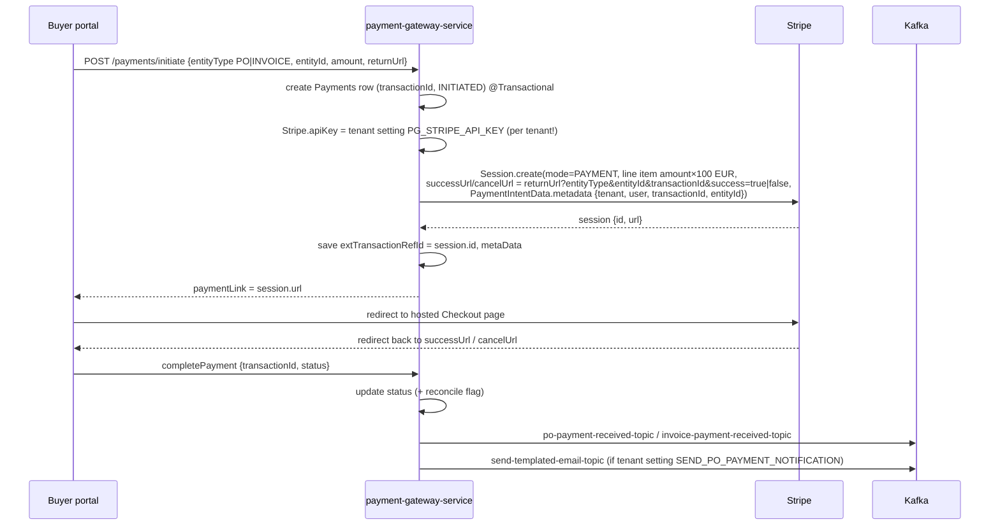

# 08: Payments with Stripe

There are two separate Stripe integrations. Know both.

## A) eProcure: paying a PO / invoice (`ep-payment-gateway-service`, Java)

### Flow

### Design points
- **Per-tenant Stripe keys**, read from tenant settings, so each buyer company uses its own Stripe account.
- **Metadata** on the PaymentIntent (tenant qualifier, transaction ID, entity ID, user) lets finance trace any Stripe payment back to our records.
- Amount: `BigDecimal × 100 → long` (Stripe uses minor units).
- **Return URL** (my 2026 fix): the new portals pass their own `returnUrl`; old portals fall back to `x-forwarded-proto://<tenant domain>/home/payment/payment-response`. That made payments work on the single `inclufy.com` domain set-up.
- **Manual payments** (bank transfer) come in on `manual-payment-creation` from the invoice service.

### Weak spot: the big one to mention
**Payment success is trusted from the browser redirect.** A user could call `completePayment` with `success=true` without paying. Fix: confirm server-side, either
1. on return, call `Session.retrieve(sessionId)` and check `payment_status == "paid"`, or (best)
2. a **Stripe webhook** (`checkout.session.completed`, `payment_intent.succeeded`) verified with `Webhook.constructEvent(payload, sigHeader, endpointSecret)`, as the source of truth, and **idempotent** (store the event ID, ignore repeats).
Also: an **Idempotency-Key** on `Session.create` so a double click doesn't create two sessions; and `Stripe.apiKey` is a **static global**. Setting it per request is a race between tenants on concurrent requests. Use `RequestOptions.builder().setApiKey(tenantKey)` per call instead.

## B) Inclufy: subscriptions (Django `payments` app)
- `stripe.Customer.create(email)` → `stripe.checkout.Session.create(mode="subscription", …)`.
- **Webhook done properly**: `stripe.Webhook.construct_event(payload, sig, secret)` checks the signature → every event is **stored in a `StripeWebhook` table** (audit + idempotency via `get_or_create` on the event ID) → handler → mark `processed=True` with `processed_at`.
- `checkout.session.completed` → set the Subscription `active`, `user.is_subscribed = True`. This **unlocks tenant provisioning**: login then shows "tenant setup in progress (N min remaining)" until the procurement/sales tenants exist (see [14](14-inclufy-sso.md)).
- Cancel: `stripe.Subscription.delete` (I fixed the cancel subscription flow).
- Course-event payments share the same webhook, routed by metadata (`course_event_id`).

## Interview Q&A

**Q: How do you integrate Stripe safely?**
A: Create a Checkout Session server-side (never send the secret key to the browser), redirect to Stripe's hosted page (PCI scope stays with Stripe), and **confirm via a signed webhook**, not the redirect. Make the webhook handler idempotent (store event IDs), and return 2xx quickly while doing heavy work async.

**Q: Why are webhooks needed if there's a success redirect?**
A: The redirect is client-controlled: the user can close the tab, fake the URL, or lose the network. Webhooks are server-to-server and signed. Some payment methods also complete later (bank debits), which only a webhook will tell you about.

**Q: How do you make payment creation idempotent?**
A: Our own `transactionId` (unique), an Idempotency-Key header on Stripe create calls, and a unique constraint on `ext_transaction_ref_id`. Webhook processing records the Stripe event ID and skips duplicates.

**Q: How do you handle money and currency?**
A: `BigDecimal` / `DECIMAL`, convert to minor units for Stripe, and store the currency with every amount. Never floating point.

**Q: How do multiple tenants use different Stripe accounts?**
A: The key is a tenant setting, encrypted at rest. Pass it per request with `RequestOptions`, not the global static `Stripe.apiKey`, which isn't thread-safe across tenants.

**Q: What's PCI DSS, and how do you stay out of scope?**
A: The card-data security standard. Using Stripe Checkout/Elements, card data never touches our servers, so we're SAQ-A (minimal scope).
