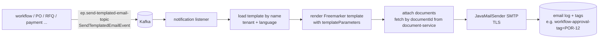

# 10: Notifications: e-mail, SMS, real-time (SSE)

## What it does
`ep-notification-service` is the **only** service that sends e-mail/SMS. Everyone else publishes an event. It also pushes live updates to the browser with **Server-Sent Events**.

## Async e-mail pipeline

### Event shape (`SendTemplatedEmailEvent`)
- `templateName`, `subject`
- `emailRecipients[]` → `{emailAddress, recipientName, type TO|CC|BCC}`
- `templateParameters[]` → `{substitutionKey, substitutionValue}` (portal URL, task ID, names…)
- `attachments[]` → `{documentId}`, which the notification service downloads itself (events stay small)
- `emailTags[]` → `{tagKey, tagValue}`, used to search the history ("all mails about POR-12")

Topics: `send-simple-email-topic`, `send-templated-email-topic`, `send-simple-sms-topic`, `send-templated-sms-topic`.
Templates are per tenant and translated (Freemarker; `spring-boot-starter-freemarker`). SMTP settings come from config/tenant settings.

## Real-time: SSE (`SseEmitterRegistry`)
- Browser: `new EventSource('/api/notification-service/sse/subscribe')`.
- Server: a controller returns an `SseEmitter`; the registry stores it in
  `ConcurrentHashMap<String key, CopyOnWriteArrayList<SseEmitter>>` where **key = tenantQualifier + user identifier** (a user may have several tabs, hence a list).
- `onCompletion`/`onTimeout`/`onError` → remove the emitter (no leaks).
- When an event for a user arrives (e.g. a task assigned), look up the emitters for that key and `emitter.send(SseEmitter.event().name("notification").data(dto))`.

Why SSE and not WebSocket: notifications are **server → client only**. SSE is plain HTTP, reconnects automatically, and goes through proxies easily. WebSocket/STOMP was used where we needed two-way traffic (IQ Helix live QR sessions, chat).

## Weak spots and how I'd improve them
- **In-memory emitters + several instances**: a user connected to instance A won't get an event consumed by instance B. Fix: every instance consumes the notification events (a unique consumer group per instance, i.e. broadcast) or use Redis pub/sub to fan out to the instance that holds the connection.
- nginx must not buffer SSE: `proxy_buffering off; proxy_read_timeout 1h;` and send heartbeats every ~30 s.
- E-mail sending needs retries with backoff and a DLT; a mail-server outage shouldn't lose mails.

## Interview Q&A

**Q: Why centralise notifications in one service?**
A: One place for templates, translations, SMTP credentials, retry, logging and unsubscribe rules. Producers just publish "send this template to these people" and never block on SMTP.

**Q: SSE vs WebSocket vs polling?**
A: Polling is simple but wasteful and slow. SSE gives one-way server push over HTTP with auto-reconnect, ideal for notifications. WebSocket is full duplex, needed for chat or collaborative editing, but you have to handle heartbeats, scaling and proxies yourself. We used SSE for notifications and STOMP over WebSocket for interactive features.

**Q: How do you scale SSE across instances?**
A: Connections are sticky to one instance. Either broadcast events to all instances (each checks whether it holds that user's emitter) through Kafka with per-instance groups or Redis pub/sub, or route users to a fixed instance. Keep the registry thread-safe (ConcurrentHashMap + CopyOnWriteArrayList) and remove emitters on timeout.

**Q: How do you avoid sending duplicate e-mails when Kafka redelivers?**
A: Use an idempotency key in the event (e.g. eventId), and keep a "sent" log with a unique constraint. If the key was already sent, skip it.
