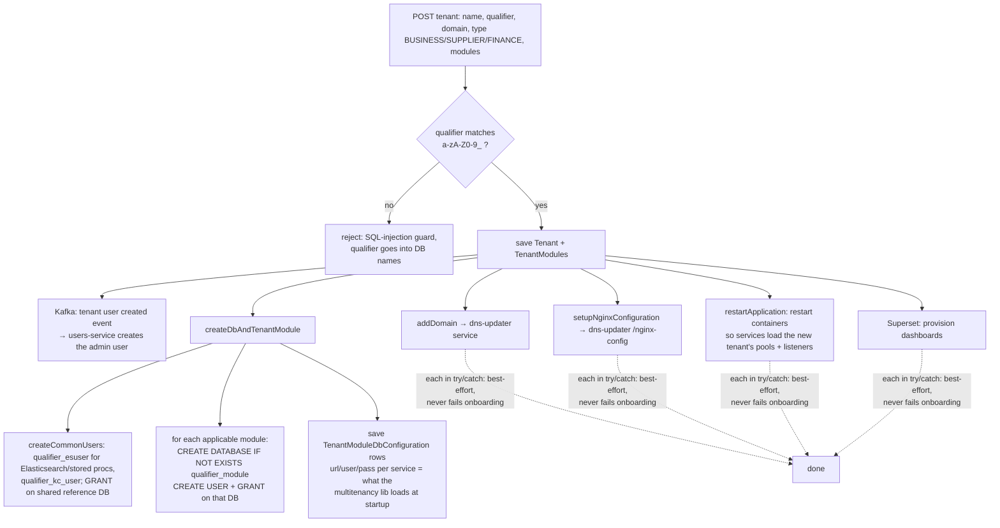

# 11: Tenant onboarding + per-tenant Superset analytics

## What it does
When a platform admin (or an Inclufy subscription) creates a tenant, `ep-tenant-service` provisions everything it needs: databases, DB users, module config, domain/DNS, nginx, a container restart, and analytics dashboards.

## Onboarding steps (`TenantService` save + `afterSave`)

- **Module types**: the tenant type picks the modules (`CLIENT`, `SUPPLIER`, `FINANCE`), via `modulesRepository.findApplicableToClientOrBoth(type)`.
- **Adding modules later**: only provisions DBs for modules that are *new* (compare with the previous module IDs; `firstNewPerModule` makes sure each module is provisioned once). I fixed duplicate tenant modules here in 2026.
- **dns-updater** (my small Python/Flask service): `/add-domain` adds DNS records (it drove the DNS provider's web console with **Selenium**, because there was no API on that plan); `/nginx-config` writes the server blocks; `/restart-containers` restarts the Docker services.
- Tenant **domain made optional** (2026): with the single `inclufy.com` gateway, tenants are picked by a header instead of a subdomain.

## Superset auto-provisioning (my 2026 feature)
Problem: every new tenant needed hand-made analytics dashboards.
Solution, `SupersetDashboardProvisioningService` (~345 lines):
1. Log in to Superset as admin (session cookie + CSRF token; a Bearer JWT showed up as anonymous on that deployment, so it couldn't create datasets).
2. **Export** the template dashboard (a business template for buyers, a supplier template for suppliers) as a ZIP bundle (YAML: dashboard, charts, datasets, database).
3. **Rewrite** it: point datasets at the tenant's Elasticsearch indices `{qualifier}_*`, rename the dashboard title/slug, and generate **deterministic per-tenant UUIDs** (name-based UUID from qualifier + original UUID), so re-running **updates instead of duplicating** (idempotent).
4. **Import** the ZIP back with overwrite.
- Hooked into `afterSave`, **best-effort** (a failure never breaks onboarding), plus an on-demand endpoint `POST /tenant/provision-analytics/{qualifier}?force=` for backfill.
- Superset is embedded **same-origin** under `inclufy.com/analytics` so the iframe works without third-party cookie problems.

## Weak spots and how I'd improve them
- The onboarding steps are **sequential side effects with no saga**: if DNS fails after the DBs are created there's no retry or compensation, just a log line. Fix: an onboarding state machine (`DB_CREATED → DNS_DONE → NGINX_DONE → ANALYTICS_DONE`) stored per tenant, with a retry job; or an orchestrated saga.
- **Restarting containers** to load a tenant is downtime for everyone. Fix: runtime pool/listener registration (see 01/03).
- Selenium against a DNS web UI is fragile. Use a DNS provider API (Route 53 / Cloudflare) or a wildcard DNS + wildcard TLS cert so no DNS change is needed per tenant.
- Raw `CREATE USER ... IDENTIFIED BY` strings: the qualifier is regex-validated (good), but passwords should come from a secrets manager and be unique per tenant.

## Interview Q&A

**Q: What happens when a new tenant signs up?**
A: (Diagram.) Validate the qualifier, save the tenant and modules, create one MySQL database and user per module, store the connection config that services load, create the admin user through an event, set up domain/nginx, and provision analytics dashboards. The infra steps are best-effort, so a DNS hiccup doesn't block the core tenant from being created.

**Q: How did you guard against SQL injection when building DB names?**
A: DDL can't use bind parameters for identifiers, so we whitelist: the qualifier must match `^[a-zA-Z0-9_]+$`, or it's rejected before any SQL is built.

**Q: Tell me about the Superset automation.**
A: (STAR) Every tenant needed dashboards by hand. I automated it with Superset's export/import API: export the template, rewrite datasets to the tenant's ES indices, rename it, give it deterministic UUIDs so it's idempotent, then import. It's hooked into onboarding as best-effort, with a backfill endpoint for existing tenants. New tenants now get analytics with zero manual work.

**Q: Why deterministic UUIDs?**
A: Superset matches objects by UUID on import. Random UUIDs would create a duplicate dashboard on every re-run. Name-based UUIDs (UUID v3/v5 from tenant + template ID) make provisioning idempotent: re-running updates in place.

**Q: How would you design onboarding for 1,000 tenants?**
A: Wildcard DNS and TLS (no per-tenant DNS), schema- or shared-DB tenancy for small tenants, an async onboarding job with a state machine and retries, runtime registration of pools and listeners (no restarts), and infra as code for anything per tenant.
