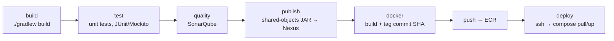

# 13: CI/CD and deployment

## Evolution (a good story by itself)
1. **Jenkins** (2022–23): a `jenkins/Jenkinsfile` per service, with Gradle build, tests, SonarQube analysis, Docker image, push.
2. **GitLab CI shared templates** (Feb 2024, I led the rollout): a central `cicd_base` repo with `.backend-microservice.yml`; each service's `.gitlab-ci.yml` just `include:`s it. One change updates 25+ pipelines.
3. **ECR + automated deploy** (2026): build → push the image to **AWS ECR** → SSH to the server → `docker compose pull && up -d` (recreate). The SSH key is passed as **base64 in a masked CI variable** (`SSH_PRIVATE_KEY_B64`) so multi-line keys survive. The same pattern was mirrored to Django, the chatbot, Upskill and the portals (`COMPOSE_FILE` selects `docker-compose.portal.yml`).
4. **IQ Helix self-hosted** (2026): staging/prod on a Mac Studio, a **Cloudflare Tunnel** for ingress (no open ports), a **webhook deploy listener** (Python) that does `git pull` + local build (images were private in GHCR) + injects the commit SHA, a `safe-redeploy.sh` with health checks, a monitor script, and persistent volumes for uploads and static files.

## Pipeline stages (backend template)

## My failure story (Feb–Apr 2024)
I pushed the new shared template to almost every service at once. Gradle permission errors ("gradle not found", wrapper not executable) broke the builds, and I had to **revert the shared template to the old working pipeline**. Fix: commit `gradlew` with the exec bit / add the wrapper JAR, then roll out again **one pilot service first**. Lesson: pilot, then roll out. In 2026 I did exactly that: eProcure first, then mirrored the pattern to the other products.

## Other production lessons
- **`/api/api` 404 (2026)**: the CI build baked `VITE_API_URL=…/api` but the app already adds `/api`, which broke login in production. Fix: origin-only URL + warning comments where people copy defaults from.
- **Stale SPA after deploy**: assets are content-hashed and cached for a year, but `index.html` had no cache header, so browsers kept the old `index.html` and requested chunks that no longer existed. Fix: `Cache-Control: no-cache, must-revalidate` on `index.html` (and repeat the security headers, because nginx `add_header` in a location block stops inheriting the parent's). Plus a `vite:preloadError` handler that reloads once.
- **Runner tags**: a job pinned to a non-existent runner tag sat "pending" forever. Removed the tag / set a default group runner tag.

## Interview Q&A

**Q: Describe your CI/CD pipeline.**
A: GitLab CI with a shared template: build and test with Gradle, SonarQube quality gate, publish shared-object JARs to Nexus, build a Docker image tagged with the commit SHA, push to ECR, then deploy by SSH plus docker-compose pull/recreate on the target host. Secrets live in masked CI variables.

**Q: How do you roll back?**
A: Images are immutable and tagged by commit SHA, so rollback = redeploy the previous tag. DB migrations must be backward compatible (expand–contract) so the old version still works with the new schema.

**Q: Blue-green vs canary vs rolling?**
A: Blue-green: two full environments, switch traffic at once, instant rollback, double cost. Canary: send a small % to the new version, watch metrics, increase gradually. Rolling: replace instances a few at a time (the Kubernetes default). Our compose setup was effectively recreate, with a short blip. On Kubernetes I'd use rolling with readiness probes.

**Q: Why tag images with the commit SHA instead of `latest`?**
A: Traceability (which code is running) and reproducible rollbacks. `latest` is mutable and ambiguous.

**Q: How do you keep secrets out of the repo?**
A: CI masked/protected variables, `.env` files on the server that aren't committed, and ideally AWS Secrets Manager or Vault injected at runtime. Base64 only gets around formatting problems; it isn't encryption.

**Q: Docker multi-stage build: why?**
A: Build in a JDK/Gradle image, copy only the jar into a slim JRE image. Smaller image, smaller attack surface, faster pulls.
