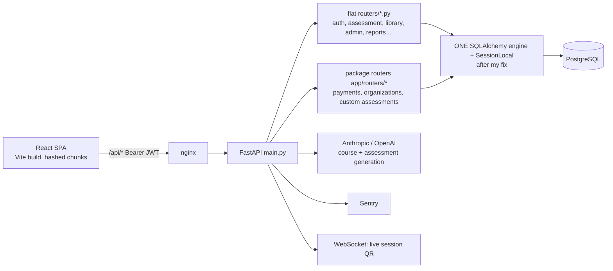

# 16: IQ Helix (FastAPI + React): leadership assessments and learning platform

## What it is
An AI-enhanced leadership platform: assessments, microlearning courses, assignments, live sessions (QR join over WebSockets), skills and badges, multi-tenant organisations, Stripe pricing, and embedding via API keys.

## Stack
- **Backend**: FastAPI, SQLAlchemy, Alembic, Pydantic settings, PostgreSQL (prod) / SQLite (dev), JWT auth, Sentry, Anthropic/OpenAI.
- **Frontend**: React + TypeScript + Vite, react-router, Radix UI + Tailwind, Axios, Context providers (Auth, Assessment, Cart).
- **Roles**: ADMIN, TENANT_ADMIN, MANAGER, VIEWER, USER, TRAINER, LIBRARY_ADMIN, SUPER_ADMIN; data scoped by `organization_id`.

## Architecture

## Production incidents I fixed (my strongest technical stories)

### 1. SQLite-only SQL on Postgres (Jul 2026)
Sentry errors kept "coming back" because SQLite-specific SQL was scattered across many files. Instead of fixing one at a time I **swept all runtime routers and services**:
| SQLite-ism | Postgres error | Fix |
|---|---|---|
| `is_active = 1` | `operator does not exist: boolean = integer` | `= true` |
| `revoked_at = ''` | invalid input syntax for timestamp | drop it, keep `IS NULL` |
| `sqlite_master`, `PRAGMA table_info` | don't exist | SQLAlchemy `Inspector.get_table_names/get_columns` |
| `datetime('now')`, `DATE('now')` | unknown function | `CURRENT_TIMESTAMP`, `CURRENT_DATE` |
I checked column types against the prod DB and ran 8 representative queries on the live DB before shipping.

### 2. Two engines, silent data loss (Jul 2026)
`app/db/database.py` created a **second engine** from a different config, without the main engine's guards. When that config resolved to SQLite, every `app/*` route threw `SQLite objects created in a thread can only be used in that same thread` (**104 events in Sentry**) and **custom assessments were written to a throwaway SQLite file**. Fix: make the package routers reuse the main engine + `SessionLocal` (one pool, one Postgres). I checked that only `get_db` (4 importers) depended on it.

### 3. Other fixes
- `GET /api/assignments` 500: after a caught DB error the session was left in an aborted transaction. Fix: **`session.rollback()`** in the except block (Postgres refuses further statements until rollback).
- "Finish course" 500: a wrong FK on `microlearning_assignments.module_id` → dropped it.
- Sentry: require an explicit DSN and report only from production (stops dev noise).
- Stale-chunk crash after deploys → `vite:preloadError` reload + no-cache `index.html` (see 13).
- Frontend hardening: guard list pages against non-array API bodies, dark-mode readability, gate screens whose backend wasn't shipped yet.

## Interview Q&A

**Q: FastAPI vs Django vs Spring Boot?**
A: FastAPI: async, type-hint driven validation (Pydantic), automatic OpenAPI, very fast to build APIs. Django: batteries included (ORM, admin, auth), great for CRUD-heavy apps. Spring Boot: the strongest ecosystem for large enterprise microservices (transactions, security, Kafka, observability). I've shipped production code in all three.

**Q: How does dependency injection work in FastAPI?**
A: `Depends()`. For example `def get_db(): db = SessionLocal(); try: yield db; finally: db.close()` gives each request a session that's always closed. Auth works the same way: `current_user = Depends(get_current_user)`.

**Q: What does `check_same_thread` mean in SQLite?**
A: By default a SQLite connection can only be used by the thread that created it. FastAPI runs sync endpoints in a thread pool, so you need `check_same_thread=False` (dev only). Production should be Postgres anyway. That's what the second-engine bug violated.

**Q: Why did errors keep coming back after fixes?**
A: Because it was a *class* of bug (SQLite dialect assumptions) spread across many files, not a single bug. The lesson: when an error type recurs, grep for the pattern and fix the class, then add a guard (refuse SQLite in prod, run CI tests against Postgres).

**Q: What happens after a failed statement in a Postgres transaction?**
A: The transaction is aborted. Every later statement fails with "current transaction is aborted" until you `ROLLBACK`. In SQLAlchemy, call `session.rollback()` in your exception handler.

**Q: How do you do migrations in Python?**
A: Alembic: `alembic revision --autogenerate -m "msg"`, review the generated script, `alembic upgrade head`. Same idea as Liquibase/Flyway.
