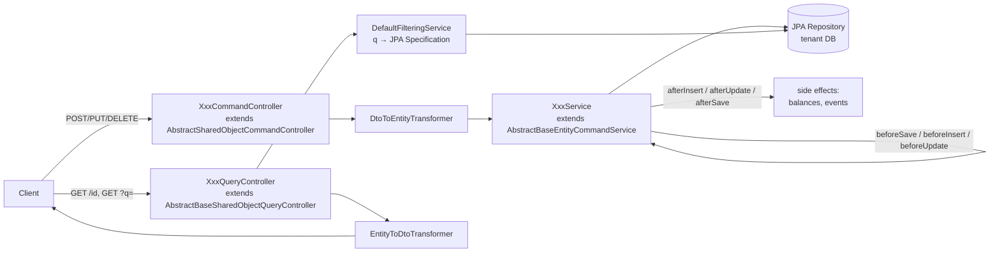
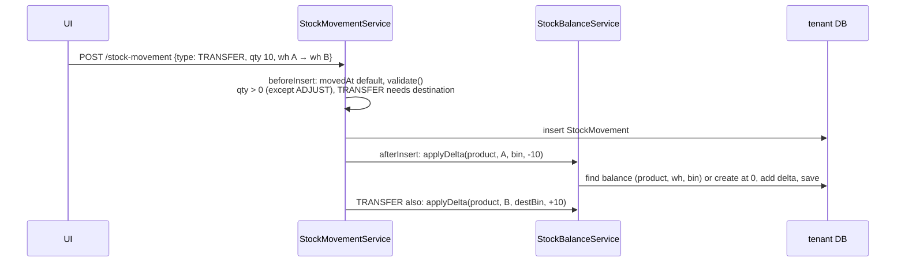

# 18: Supply-chain services: inventory, manufacturing, logistics, operations (my 2026 work)

These are the newest eProcure services, and they're **your own code** (git history: `kafka topics added`, `transformers added`, `bin, lot, stocks, warehouses fixed`, May–Jun 2026). Expect deep questions on them: "you built an inventory service, how did you keep stock correct?"

| Service | Domain | Main entities |
|---|---|---|
| `ep-inventory-service` | Stock | Warehouse, Bin, Lot, StockMovement, StockBalance, CycleCount (+ lines) |
| `ep-manufacturing-service` | Production | BillOfMaterials (+ lines), Routing (+ steps), WorkCenter, ProductionOrder (+ lines), ProductionSchedule, QcInspection, ScrapRecord, Asset, MaintenanceWorkOrder |
| `ep-logistics-service` | Moving goods | Carrier, Shipment (+ lines), DeliveryRoute, ReturnOrder (+ lines), FreightInvoice |
| `ep-operations-service` | Management/insight | SupplierRiskScore, RiskAlert, ComplianceRecord, EsgMetrics, ExecutiveKpi, SpendCategory, MonthlyTrend, SavingsInitiative, TimeEntry, TimeApprovalRequest, Report… |

## 1. The shared service skeleton (same in every eProcure service)

Every one of these services is built on the in-house library **`application-essentials`** (`com.tmt.core`). Knowing it lets you explain *any* service.

- **Command/Query split (CQRS-lite):** separate controllers for writes and reads on the same path, e.g. `StockMovementCommandController` and `StockMovementQueryController` both on `/stock-movement`. The controller classes are often **empty**: they just extend the generic base with type parameters `<Entity, ID, DTO>`. The base gives `POST`, `PUT /{id}`, `DELETE /{id}`, `GET /{id}`, `GET` (paged).
- **Template Method hooks:** `AbstractBaseEntityCommandService.save()` calls `beforeSave → beforeInsert|beforeUpdate → repository.save → afterInsert|afterUpdate → afterSave`. Business logic lives in those hooks. That's why services are short.
- **Transformers:** one class per direction (`LotDtoToEntityTransformer`, `LotEntityToDtoTransformer`). They're found by type through a `TransformerService`, so the controller never touches entities directly.
- **Generic filtering:** `GET /stock-movement?q=productId:5,movementType:IN&page=0&size=20&sort=movedAt,desc`. `QueryCriteriaConfig` registers a Spring `Converter` that splits `q` on `,` into criteria `key:operator+value`. Operators: `EQUALS, LIKE, LARGER_THAN, SMALLER_THAN, RANGE_*, IN, START_WITH, IS_NULL`. `DtoField2EntityFieldMapper` maps DTO field names to entity paths, and `DefaultFilteringService` turns them into a **JPA `Specification`**. A service can plug in a custom `SpecificationComposer`.
- **Disabling operations:** mix in `DisabledDeleteOperation` etc. to make an entity append-only.

## 2. Inventory: how stock stays correct

### Data model
- `Warehouse` → `Bin` (a location inside a warehouse) → `Lot` (batch with `LotStatus`, expiry).
- **`StockMovement`** = an immutable ledger row: `movementType` (`IN`, `OUT`, `TRANSFER`, `ADJUST`, `SCRAP`), product, warehouse/bin/lot, quantity, UOM, `referenceType/referenceId` (what caused it: PO, production order, CYCLE_COUNT…), `movedAt`, reason.
- **`StockBalance`** = the current quantity per **(product, warehouse, bin)**. It's a **materialised view of the ledger**, kept in step on every movement.

### The movement flow (`StockMovementService`)

Sign rules (`sourceDelta`): `IN → +qty`, `OUT/SCRAP/TRANSFER → -qty`, `ADJUST → signed qty from caller`.

### Cycle counts (stocktaking)
`CycleCount` with lines `{product, bin, lot, expectedQty, countedQty}`. When it's updated to **`COMPLETED`**, `afterUpdate` creates an **`ADJUST` movement for each line's variance** (`counted - expected`, skipping zero), with `referenceType = "CYCLE_COUNT"`. So the balance is never edited directly; **every change is a ledger row** you can audit.

### Events
- Publishes (`StockMovementEventProducer`): `stock-movement-topic`, `product-stock-update-topic`, `inventory-valuation-topic`. It goes through the shared `MultiTenantKafkaEventProducer`, so the topic becomes `ep.<tenant>.stock-movement-topic` (see 03).
- Consumes (`TenantAwareKafkaListener`s): `goods-receipt-topic` (from PO service), `production-event-topic` (manufacturing), `shipment-event-topic` (logistics), `tenant-provisioned-topic` (to create the schema/topics for a new tenant).

### Weak spots (say these yourself, they're real)
1. **Lost update on `StockBalance`:** `applyDelta` is read → add → save. Two concurrent movements on the same (product, bin) can both read 100 and write 90 and 95. Fixes: `@Version` optimistic locking + retry; or `SELECT … FOR UPDATE` (`@Lock(PESSIMISTIC_WRITE)`); or an atomic SQL `UPDATE stock_balance SET qty = qty + :delta WHERE …`; plus a **unique constraint** on (product, warehouse, bin) so two "create at 0" races can't make duplicate rows.
2. **Transaction boundary (this one is handled):** `AbstractBaseEntityCommandService` is annotated `@Transactional` at class level, so the movement insert and the balance updates in `afterInsert` commit or roll back **together**; `applyDelta`'s own `@Transactional` just joins (propagation `REQUIRED`). Be ready to explain that.
3. **No negative-stock check** on `OUT`. Add a rule (per warehouse setting) to reject or allow backorders.
4. **The listeners only log today**: goods receipt / production / shipment events don't yet create movements, and the producers aren't called yet. The next step is: listener → build `StockMovement` with `referenceType` = source → `save()`, made **idempotent** by a unique key on `(referenceType, referenceId, lineNo)` so a redelivered Kafka message doesn't double-count.
5. **Dual write:** saving to MySQL and publishing to Kafka aren't atomic. Use the **transactional outbox** (see 03).

## 3. Manufacturing
- **BOM** (`BillOfMaterials` + `BomLine`: which components and quantities make one finished product, `BomStatus`).
- **Routing** + `RoutingStep`: the sequence of operations, each at a **WorkCenter** (`WorkCenterType`: machine, labour…).
- **ProductionOrder** lifecycle: `DRAFT → PLANNED → RELEASED → IN_PROGRESS → COMPLETED → CLOSED` (or `CANCELLED`). `ProductionSchedule` places orders on work centres.
- **Quality and waste:** `QcInspection` (`QcInspectionType`, `QcResult`), `ScrapRecord`.
- **Maintenance:** `Asset` (`AssetStatus`) and `MaintenanceWorkOrder` (`MaintenanceType`: preventive or corrective; `MaintenanceStatus`).
- Events: publishes `production-event-topic` (finished qty + consumed materials → inventory does `IN` for finished goods and `OUT` for components) and `maintenance-event-topic`; consumes `stock-movement-topic`.
- Code pattern: services wire child lines to the parent in `beforeInsert/beforeUpdate` (`line.setProductionOrder(entity)`). That's needed because the `@OneToMany(mappedBy, cascade = ALL)` owning side is the child; the JSON only fills the parent's list.

**Q: How would you implement "complete a production order"?**
A: In one transaction: status → COMPLETED, write an outbox row for `ProductionCompleted {orderNo, finished: {product, qty}, consumed: [{product, qty, lot}]}`. Inventory consumes it: one `IN` movement for the finished product and one `OUT` per component (backflushing), each idempotent on `(PRODUCTION_ORDER, orderNo, line)`. Add a state-machine check so you can't complete a DRAFT order.

## 4. Logistics
- **Carrier** (`CarrierType`), **Shipment** (+ lines, `ShipmentDirection` inbound/outbound) with status `DRAFT → PLANNED → READY_FOR_PICKUP → IN_TRANSIT → OUT_FOR_DELIVERY → DELIVERED` (or `CANCELLED`/`RETURNED`), **DeliveryRoute**.
- **ReturnOrder** (+ lines) with `ReturnDirection` (customer return or return to supplier), `ReturnReason`, `ConditionCode` (resellable, damaged…), `ReturnStatus`.
- **FreightInvoice** (`FreightInvoiceStatus`): the carrier's bill, which can be matched to shipments.
- Events: publishes `shipment-event-topic`, `return-event-topic`, `freight-invoice-draft-topic` (so the invoice service can draft an AP invoice), `shipment-notification-topic` (customer emails through the notification service); consumes `stock-movement-topic`.

**Q: How do you model a shipment status flow safely?**
A: An enum plus an explicit **allowed-transitions map** (`IN_TRANSIT → OUT_FOR_DELIVERY` ok, `DELIVERED → PLANNED` rejected) checked in `beforeUpdate`; `@Version` on the entity so two updates from a carrier webhook and a user don't overwrite each other; and an event per transition for tracking and notifications.

## 5. Operations: risk, compliance, reporting

### Supplier risk scoring (`RiskScoringEngine`, `POST /supplier-risk-score/recompute`)
A **deterministic, explainable** rule-based score from 0 to 100:
1. Take **open** risk alerts (not resolved/closed/dismissed) and open compliance gaps (`non_compliant`, `overdue`, `open`).
2. Each alert adds a **severity weight** (CRITICAL 25, HIGH 15, MEDIUM 8, LOW 3) to a bucket picked by its type: financial (credit, payment), operational (delivery, quality, and anything unknown), geopolitical (country, sanctions), reputational (brand, ESG), supply chain (lead time, shortage).
3. Compliance gaps add a weight (12/8/4/2) split between operational and reputational.
4. Clamp each bucket to 100. **Overall = 0.25·financial + 0.20·operational + 0.15·geopolitical + 0.15·reputational + 0.25·supplyChain** (financial and supply chain weigh most: they threaten the ability to pay or deliver).
5. Map to a band (LOW/MEDIUM/HIGH/CRITICAL), compute the **trend** against the previous snapshot, set `nextAssessmentDue = +90 days`, and save a **reasons list** ("[HIGH] late deliveries Q2", "Compliance gap: ISO 9001"), so the UI can explain the number.
6. The latest row is **updated in place** (stable ID, cheap "current score" query). The pure `score()` method is exposed so the AI copilot can compute what-if scores without saving. An LLM batch can later add richer `aiInsights`.

**Q: Why rule-based and not ML?** Explainability and auditability (procurement teams must justify blocking a supplier), no training data yet, deterministic tests. ML or LLM can come later as an *additional* signal.

### Reports (`ReportExecutionController`)
`GET /report/canonical-types`, `POST /report/{id}/run` (aggregation through `ReportingAggregationService` → `ReportData`), `POST /report/{id}/export` → **PDF (iText)** or **Excel (Apache POI `XSSFWorkbook`)** as `byte[]`.
- Improve: for big reports, stream with `SXSSFWorkbook` (keeps only a window of rows in memory) and run the export **async** (job ID → poll/notify → download from S3).

### Scheduling and approvals
- `OperationsScheduleTaskProducer` sends a task to `ep.<prefix>.<task-scheduler-submit-topic>`. The **task scheduler service** (see 12) calls back at the due time, and `ScheduleExecutedHandler` implementations (`RiskReviewScheduleHandler`, `ReportRunScheduleHandler`, `TimeSummaryScheduleHandler`) run the job. Strategy pattern: each handler says which task name it handles.
- `OperationsWorkflowDispatchService.start(...)` starts an approval in the workflow service (see 05). `ReportTaskApprovedRejectHandler` / `RiskAlertTaskApprovedRejectHandler` react to `task-approved-rejected-topic`.
- Time tracking: `TimeEntry` → `TimeApprovalRequest` (approval) against a `ContractTimeBudget` (hours budget per contract).

## Interview Q&A

**Q: Walk me through your inventory service design.**
A: An event-sourced-style ledger: every stock change is an immutable `StockMovement` (IN/OUT/TRANSFER/ADJUST/SCRAP) with a reference to its cause, and `StockBalance` per product/warehouse/bin is updated in the same flow, so reads are cheap. Transfers write two deltas; stocktakes produce ADJUST movements for the variance, never direct edits. It publishes stock events on Kafka and listens to goods receipts, production and shipments.

**Q: Why keep both a ledger and a balance table?**
A: The ledger gives audit and history (and lets you rebuild balances); the balance gives O(1) "how much is in bin X" reads. Summing the ledger on every read wouldn't scale. A nightly reconciliation job can compare the sum of movements with the balance and alert on drift.

**Q: Two users ship the last unit at the same time. What happens?**
A: Today both could succeed (lost update, no negative check). The fix: atomic `UPDATE … SET qty = qty - :n WHERE … AND qty >= :n` and check the updated row count (0 means not enough stock), or optimistic locking with retry. That's the classic inventory-reservation problem.

**Q: What's CQRS and is this CQRS?**
A: Command Query Responsibility Segregation: separate write and read models. We separate the **controllers and code paths** but use the same tables. Full CQRS would project events into separate read stores, like we do for search with Elasticsearch (see 07).

**Q: How do you make a Kafka consumer idempotent here?**
A: A natural business key on the side effect (`referenceType + referenceId + line`) with a unique constraint, or a `processed_events(event_id)` table checked and inserted in the same transaction as the side effect.

**Q: How did you add a new microservice to the platform?**
A: Copy the service skeleton (Gradle, `application-essentials`, `tmt-multitenancy`, Liquibase changelog, Kafka config), define entities + DTOs + transformers, extend the generic command/query controllers, add Liquibase changesets (run per tenant), register the ACL resources (see 02), add the gateway route and port, the GitLab CI template include and the compose entry (see 13), and listen to `tenant-provisioned-topic` so new tenants get it automatically.
