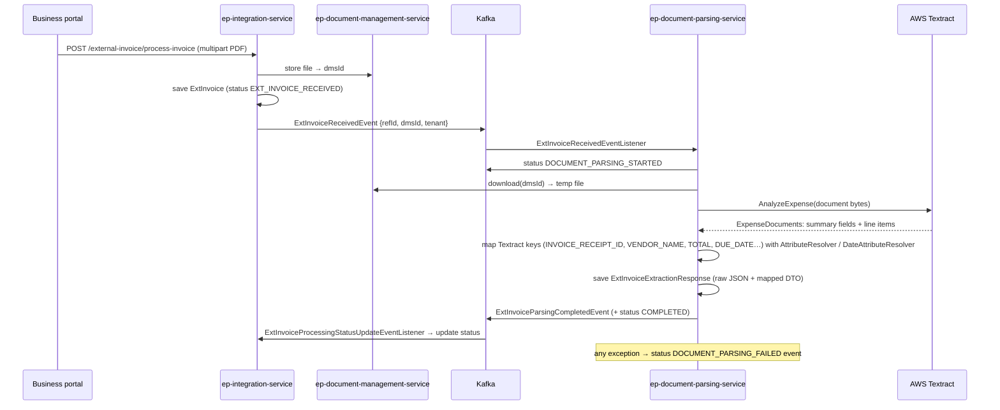
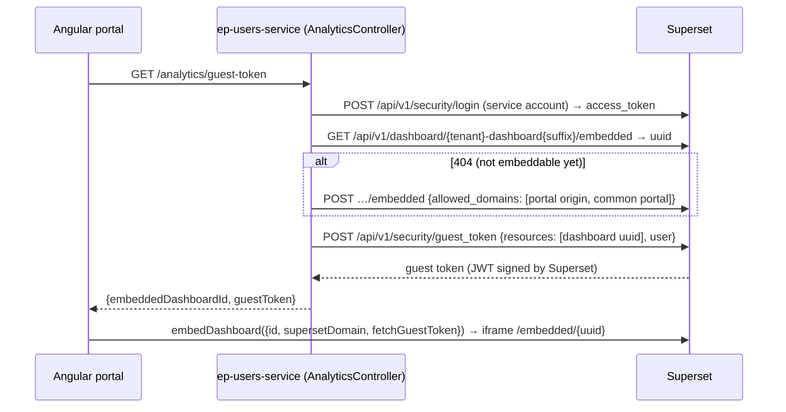

# 19: Supporting services: invoice OCR, UBL e-invoicing, budgets, analytics pipeline, embedded Superset, Eureka

Smaller services that interviewers like because each one shows a single clear pattern.

## 1. External invoice scanning with AWS Textract (`ep-integration-service` + `ep-document-parsing-service`)

A supplier who isn't on the platform emails or uploads a PDF invoice. We turn it into structured data automatically.

- Status machine: `EXT_INVOICE_RECEIVED → DOCUMENT_PARSING_STARTED → DOCUMENT_PARSING_COMPLETED | DOCUMENT_PARSING_FAILED`, reported back **by events**, so the integration service owns the status and the parser stays stateless.
- Why Textract **AnalyzeExpense** instead of plain OCR (`DetectDocumentText`)? It already understands invoices and receipts: it returns typed summary fields and line-item groups, not just lines of text.

**Weak spots / improvements**
- Synchronous `AnalyzeExpense` limits the size and page count; for multi-page PDFs use the async `StartExpenseAnalysis` with an S3 object + SNS completion.
- Writing to a local temp file: use the bytes directly (or S3), and always delete temp files.
- Add **confidence thresholds**: low-confidence fields go to a human review screen (human-in-the-loop), then auto-match to PO + goods receipt (**3-way match**).
- Textract client built per call: reuse a singleton client (it's thread-safe).

**Q: How would you make OCR processing reliable at scale?**
A: Queue-based (we use Kafka), idempotent per invoice ID, retries with backoff plus a DLT for poison documents, async Textract for big files, status events for the UI, and metrics on the failure rate and average confidence.

## 2. UBL e-invoicing (`ep-ubl-service`)
**UBL 2.1** (Universal Business Language, OASIS XML standard) is the format behind **Peppol** e-invoicing used across Europe; many governments require it.
- `InvoiceCreatedEventListener` consumes `invoice-created-topic` → `InvoiceUBLFileGeneratorService.generateUblInvoice(dto)`.
- `POST /ubl/download` (produces `application/xml`) generates UBL for an invoice or PO on demand.
- **Strategy + Factory:** `DataMarshallerFactory` gets `List<DataMarshaller>` injected (Spring injects every implementation) and picks the first with `isApplicable(EntityType)` → `InvoiceDataMarshaller` or `PurchaseOrderDataMarshaller`. Both extend `AbstractDataMarshaller` (Template Method: fetch by ID or reference through a Feign client → transform to the UBL object → marshal to XML).
- Libraries: **ph-ubl21** (helger) generated JAXB classes + `ph-jaxb` for marshalling, plus an internal `ep-ubl-lib`.

**Q: How do you add a new document type (credit note)?**
A: Add a `CreditNoteDataMarshaller` bean. The factory picks it up with no change to the factory (open/closed principle).

**Q: JAXB marshalling: what is it?** Mapping between Java objects and XML through annotations; `Marshaller` writes XML, `Unmarshaller` reads it. With a schema (XSD) you can validate before sending.

## 3. Budgets and spend control (`ep-spend-mgmt-service`)
- `Budget`: amount, `amountUtilized`, `unpaidInvoiceAmount`, `pendingInvoiceAmount`, `unusedAmount`, period, department, `notificationThreshold` (%), `isStrictBudgetControl`, approvers/owners, status `DRAFT → PENDING_APPROVAL → APPROVED | PARTIALLY_APPROVED | REJECTED`, `InternalBudgetType` = `GLOBAL` or `CONTRACT`.
- **Approval** through the workflow engine (`BudgetApprovalWorkFlowService`, `TaskApprovedRejectedListener`, see 05).
- **Auto budget from contract:** `ClientContractApprovedListener` → `autoCreateBudgetFromContract`: an approved contract creates an APPROVED `CONTRACT` budget for the contract amount and dates.
- **Spending:** `spendBudget(budgetNumber, amount)` adds to `amountUtilized` and recalculates `unusedAmount`.
- **Threshold alert:** `BudgetThresholdExceedEmailNotificationService.isApplicable` checks `utilized/amount·100 > notificationThreshold` → a templated email event (Strategy pattern through the `BudgetEmailService` interface).
- **Validation:** `BudgetCreationValidator implements CommandValidator`. The base library runs every applicable validator before a save.

**Weak spot (great interview point):** `spendBudget` is **read-modify-write** with no lock, so two POs spending at the same time can lose an update and overspend. Fix with an atomic update `UPDATE budget SET amount_utilized = amount_utilized + :amt WHERE budget_number = :n AND (is_strict = false OR amount - amount_utilized >= :amt)` and check the row count, or `@Version` + retry. Also make it **idempotent** per PO (store which PO consumed how much; a ledger again, like inventory).

## 4. Analytics data pipeline (`ep-analytics-service`) with Kafka Connect
Gets transactional data from each tenant's MySQL into Elasticsearch for dashboards **without writing ETL code**.

```mermaid
flowchart LR
  T[tenant analytics request event] --> A[ep-analytics-service<br/>TenantAnalyticsRequestEventListener]
  A -->|ProcessorFactory: CREATE / RECREATE / DROP| KC[Kafka Connect REST API]
  KC --> J[JDBC Source connector<br/>per module + tenant]
  J -->|rows as records| KT[(Kafka topic)]
  KT --> E[Elasticsearch Sink connector]
  E --> ES[(ES index per module/tenant)]
  ES --> SS[Superset dashboards]
```

- For each analytics module (POs, invoices, spend…) and tenant, `CreateProcessor` registers a **JDBC source connector** (reads the tenant DB with the DB config fetched from the tenant service) and an **ES sink connector** (`<module>_jdbc_<ts>` / `<module>_es_<ts>`). `DropProcessor` removes them; `RECREATE` = drop + create.
- `GET /analytics/analytic-modules` lists the modules.

**Q: Kafka Connect vs writing your own consumer?** Connect is a framework for moving data in and out of Kafka through configuration: offsets, scaling, retries and converters are handled for you. Custom consumers fit business logic; Connect fits plain data movement.
**Q: JDBC source modes?** `bulk` (whole table each poll), `incrementing` (new rows by ID), `timestamp` (updated rows by an `updated_at` column), `timestamp+incrementing` (the safest). Deletes aren't captured; for that use **CDC with Debezium** (reads the MySQL binlog). That's what I'd move to.

## 5. Embedded Superset dashboards with guest tokens (the Jun 2026 investigation)
The supplier/business portals show a Superset dashboard **inside the page**.

- The **backend** holds the Superset credentials; the browser only ever gets a short-lived **guest token** scoped to one dashboard (optionally with row-level-security clauses).
- **Self-healing:** if the dashboard has no embedded UUID yet, the service creates it.
- **What I debugged and fixed:** the embed failed because the users service pointed at the wrong Superset host/port from inside Docker (`localhost` vs the host gateway). I fixed the env config, served Superset **same-origin** at `/analytics/` behind each tenant's nginx (`proxy_pass` + `X-Forwarded-Prefix`, Superset `ENABLE_PROXY_FIX`) so there were no third-party-cookie or CSP `frame-ancestors` problems, and changed `createEmbeddedMapping` to also allow the common portal domain in `allowed_domains`.

**Q: How do you embed a BI dashboard securely?**
A: Backend-for-frontend issues a short-lived guest token scoped to the dashboard and tenant (row-level security per tenant); never expose admin credentials; restrict `allowed_domains` (CSP frame-ancestors); serve same-origin if you can, to avoid cookie and CORS problems.

## 6. Service discovery: `ep-discovery-service` (Eureka) and why we didn't really use it
- It's a plain `@EnableEurekaServer` on port 8761 (`register-with-eureka: false`, `fetch-registry: false`: it's the registry itself).
- But the gateway routes use **static URIs** (`http://<host>:8202/` …) and no service registers with Eureka. In Docker Compose and Kubernetes, **DNS-based discovery** (service names) does the job, so Eureka was unnecessary.

**Q: Client-side vs server-side discovery?**
A: Client-side (Eureka + Spring Cloud LoadBalancer, `lb://service-name`): the client asks the registry and picks an instance. Server-side (Kubernetes Service, AWS ALB): the client calls one stable name and the platform load-balances. On Kubernetes I'd use server-side and drop Eureka.

## 7. Other small ones (one line each, enough to answer)
- **`ep-document-management-service`**: upload, download and metadata for files (attachments, contracts, invoice PDFs), referenced elsewhere by `dmsId`.
- **`ep-master-data-service`**: tenant master data: UOM, tax groups, material groups, product codes, invoice types and periods… (hundreds of small CRUD entities on the generic base controllers).
- **`ep-reference-data-shared-service`**: data **shared across tenants**: standard product categories, brands, attributes, product types.
- **`ep-translation-service`**: i18n keys per language and tenant (the `*.csv` translation files in the repo root are the imports).
- **`database-cleanup` scripts** (Python): find tenant databases with no real users and orphaned tenant metadata, with a **dry-run mode** first. Good answer to "how did you clean up test tenants safely?"
