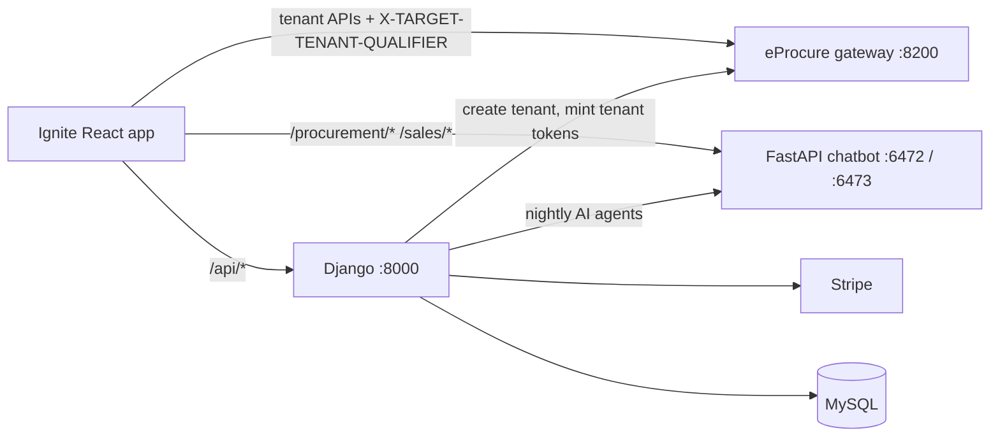

# 20: Inclufy Django platform: apps, scheduler, tenant provisioning, AI agents, automation rules

File 14 covers login/SSO. This file covers **the rest of the Django backend** (`Inclufy-Django-Backend`, Django 5.2 + DRF + SimpleJWT, MySQL in prod / SQLite in dev).

## Where Django sits

Django is the **platform layer** (accounts, subscriptions, tenant profiles, settings, chat history, marketing site content). eProcure is the **product layer** (procurement and sales data per tenant).

## Apps and what each one holds
| App | Models | Purpose |
|---|---|---|
| `accounts` | CustomUser, VerificationToken, PasswordResetToken, TenantAPIKey, **UserTenantAssociation**, LoginHistory, UserSession | Users, email verification, password reset, invited users linked to tenants, login audit, active sessions |
| `payments` | StripeCustomer, Subscription, **StripeWebhook**, **TenantProfile**, TenantApplication | Stripe subscriptions (see 08), the tenant profile per customer (procurement/sales tenant IDs, domains, qualifier, created-at timestamps) |
| `ai_settings` | UserAISettings, OrgAISettings, PersonalApiKey, UserApiKey, UserGeneralSettings | Which AI provider/model a user or org uses; **bring-your-own-key** (see 15) |
| `chat` | Chat, Message | Copilot conversation history |
| `automation` | AutomationWorkflow, AlertRule, ActiveAlert, ApprovalRequest | No-code rules and alerts (below) |
| `contract_intel` | ContractKPI, SLADefinition, SLABreach, SupplierEvaluation, ContractSummary | Contract performance: KPIs with target/actual/weight/trend, SLA breaches, AI insights |
| `risk_compliance`, `reporting`, `time_tracking` | SupplierRiskScore, ESGMetrics, ComplianceRecord, RiskAlert, ExecutiveKPI, SpendCategory, TimeEntry… | First versions of these features. **The same models were later rebuilt in Java as `ep-operations-service`** (see 18) so they live per tenant next to the procurement data |
| `marketing`, `contact`, `back_office` | PricingPlan/Card/FAQ, ContactSubmission, NewsLetter, CourseEvent, EnterpriseQuotation | Website content managed through Django admin, events, enterprise quotes |
| `demo` | 74 Demo* models | A complete demo dataset (orgs, suppliers, POs…) for sales demos without a real tenant |
| `scheduler` | (django-apscheduler job store) | Background jobs (below) |

**Q: Why did you move risk/compliance from Django to a Spring service?**
A: Data locality and tenancy. Django stored it in one shared DB keyed by tenant, while every other procurement entity lives in the tenant's own MySQL behind the eProcure gateway with ACLs, Kafka events and workflow approvals. Moving it into `ep-operations-service` gave it tenant isolation, the same ACL model, and direct access to the workflow engine and scheduler.

## The scheduler (django-apscheduler)
`BackgroundScheduler` with a **`DjangoJobStore`** (jobs and run history are stored in DB tables, visible in Django admin). Started from the app config or manually with `start_scheduler.py` (signal handlers for a clean shutdown).

| Job | Trigger | What it does |
|---|---|---|
| `process_pending_tenant_profiles` | every N min (1 dev / 3 prod) | **Tenant provisioning, step two** (below) |
| `delete_old_job_executions` | Mon 00:00 | Prunes job history |
| `ai_contract_intelligence` | daily 02:00 | AI agent run per tenant |
| `ai_supplier_risk` | 03:00 | " |
| `ai_spend_intelligence` | 04:00 | " |
| `ai_esourcing_evaluation` | 05:00 | " |
| `ai_sales_deal_intelligence` | 06:00 | " |
| `ai_invoice_matching` | 07:00 | " |
| `ai_market_intelligence` | Mon 08:00 | " |

Jobs are wrapped with `@util.close_old_connections`, because a long-running background thread otherwise keeps a **stale DB connection** (MySQL closes idle connections after `wait_timeout`, giving "MySQL server has gone away").

### Tenant provisioning, step two
1. On subscription (Stripe webhook, see 08), Django asks the eProcure tenant service to create the procurement and/or sales tenant (see 11) and stores `procurement_tenant_created_at` / `sales_tenant_created_at` on `TenantProfile`.
2. Creating the DBs, running Liquibase, DNS and Superset takes a while, so the job picks profiles where `invitation_send_by_celery = False` **and** a tenant was created **≥ 20 minutes ago** (Django `Q` objects with OR).
3. For each: get a platform token (`get_external_auth_token`), **attach the languages** to the tenant (`attach_language_to_tenant`), **send the admin invitation** (`send_invitation`), then set the flag to True so it's never processed twice.
4. The login screen uses the same 20-minute window to show "setup in progress, N min left" (see 14).

**Weak spots / improvements**
- A **fixed 20-minute wait** is a guess. Better: the tenant service publishes `tenant-provisioned` (it already exists on Kafka) and Django reacts to it, or polls a readiness endpoint.
- APScheduler inside the web process runs once **per process**: with 4 gunicorn workers you get 4 schedulers and duplicate jobs. Run it as **one dedicated process** (what `start_scheduler.py` is for) or use Celery beat; for safety add a DB lock (`select_for_update(skip_locked=True)`) per profile.
- The flag name `invitation_send_by_celery` is left over from an earlier Celery version, which is a good story about migrating Celery → APScheduler to drop Redis/RabbitMQ from a small deployment.

### Nightly AI agents
`trigger_ai_agent(agent_type)` loops over **active** tenant profiles and calls the chatbot backend `POST /ai-agents/trigger {agent_type, auth_token, portal_type}` (timeout 300 s). The agent reads tenant data through the tools (see 15), writes insights back (for example `ai_insights` on contract KPIs, supplier risk), and returns a summary (`analyzed` count). Staggered hourly so the jobs don't overload the LLM provider rate limits.

**Improve:** fan out with a queue (one message per tenant per agent) instead of a sequential loop; per-tenant cost limits; record each run's status for the UI.

## Automation rules (`automation` app)
A no-code rule engine stored as JSON:
- `AutomationWorkflow`: `trigger_type` (metric threshold, schedule, event) + `trigger_config` (`{metric, operator, value, schedule, eventType}`), `conditions` (`[{field, operator, value, logicalOperator}]`), `actions` (`[{type, order, notificationType…}]`), status draft/active.
- `AlertRule`: metric + operator + threshold + severity + `notify_via` (push/email/in-app) + recipients + `escalate_to`. When a rule fires it creates an **`ActiveAlert`** (current value vs threshold, entity, status active/acknowledged/resolved).
- `ApprovalRequest`: lightweight approvals created by workflow actions.

**Q: Why JSON fields instead of normalised tables for conditions/actions?**
A: The schema changes often (new action types) and conditions are always read and written as a whole with their workflow, never queried one by one. JSONField keeps it flexible and saves joins. The trade-off: no DB-level validation, so we validate with DRF serializers. If we needed "find all rules using metric X" often, I'd add an indexed column or a separate table.

**Q: How would you evaluate rules at scale?**
A: Event-driven: metric changes publish events; a rule engine loads the active rules per tenant (cached), evaluates them, and de-duplicates alerts (one open alert per rule + entity). Use scheduled evaluation only for time-based rules.

## Interview Q&A

**Q: Django vs Spring Boot: why both in one company?**
A: Spring Boot runs the multi-tenant product core (transactions, Kafka, per-tenant DBs, strong typing for a big team). Django was the fastest way to build the commercial platform around it: accounts, Stripe, an admin UI for marketing content, and quick AI-feature prototypes. The admin site alone saved weeks.

**Q: How does Django's ORM avoid N+1?**
A: `select_related` (SQL JOIN for FK/one-to-one) and `prefetch_related` (a second query + join in Python for many-to-many/reverse FK). Check with `django-debug-toolbar` or `assertNumQueries` in tests.

**Q: What are Django signals and when would you avoid them?**
A: Hooks like `post_save`; useful for decoupling, but they hide control flow and run in the same transaction/thread. For important side effects (sending emails, calling APIs) I prefer explicit service calls or `transaction.on_commit()` so nothing runs if the transaction rolls back.

**Q: How do you run background jobs in Django?**
A: Options: Celery + Redis/RabbitMQ (distributed, retries, the standard), django-apscheduler (simple, in-process, DB job store: what we used), Django-Q / Dramatiq / RQ, or cron + management commands. Pick by scale: we had a few periodic jobs, so APScheduler avoided running a broker.

**Q: What is DRF's request lifecycle?**
A: URL → view (`APIView`/`ViewSet`) → authentication classes (SimpleJWT `JWTAuthentication`) → permission classes → throttling → serializer validation (`is_valid()`) → save → response renderer.
