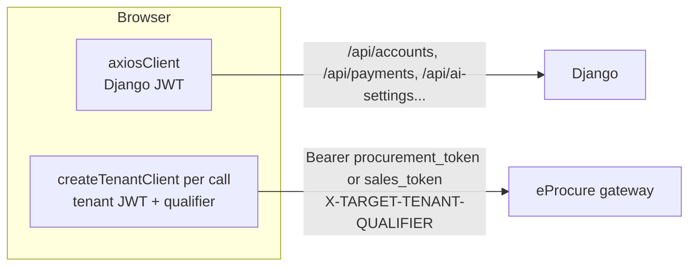
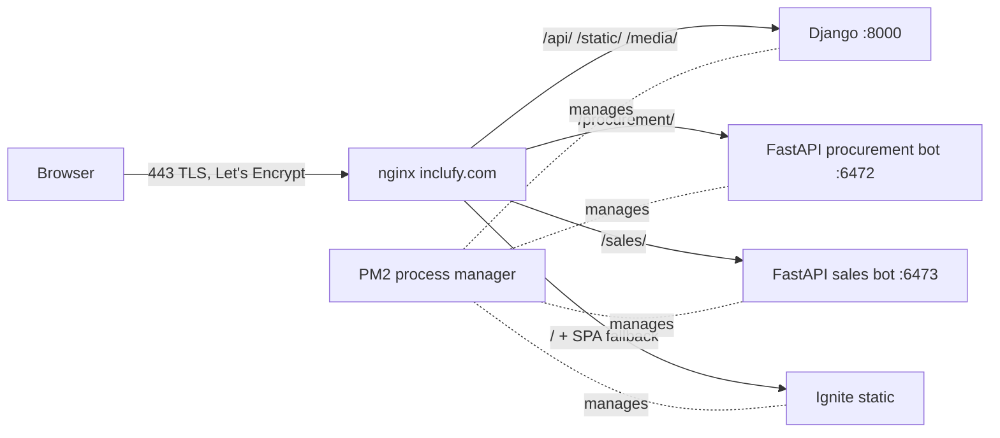

# 21: Inclufy Ignite (React + TypeScript) and how Inclufy is deployed

**Ignite** is the main Inclufy web app: one React SPA for both portals (Procurement and Sales), the AI copilot, settings, admin, marketing pages and the marketplace. It **replaced the older `Inclufy-AI-Chatbot-Frontend`** (React 19 + Redux Toolkit, JavaScript). **You led that migration** (`docs/MIGRATION_TRACKER.md`, Feb 2026: 46 tasks, assignee Sachin): auth system, API layer, chat, settings, AI providers, public pages.

## Stack
React 18 + **TypeScript** + **Vite**, **react-router v6**, **TanStack React Query v5** (server state), React Context + small hook-based stores (UI state), **shadcn/ui** (Radix UI primitives + Tailwind), react-hook-form + **zod** (forms and validation), Axios, Recharts, i18next, Sentry, Vitest.

## Structure
```
src/
  lib/        axiosClient.ts (Django API), tenantAxiosClient.ts (eProcure gateway), portalServiceMap.ts,
              aclPermissions.ts, navItemAclMap.ts, copilotToolRegistry.ts, sentry.ts
  services/   one file per backend area: authService, invoicesService, inventoryService, contractService,
              epLogisticsService, budgetService, chatService, iamService, ...
  hooks/      useAuth, useTenants, useEntitlements, useChatStore, useCopilotStore, useRealtimeNotifications, ...
  contexts/   PermissionsContext.tsx
  components/ feature folders: orders, invoices, inventory, logistics, manufacturing, esourcing, contracts,
              risk-compliance, automation, copilot, chat, settings, admin, marketplace, ...
  pages/      routed pages, ~49 of them lazy-loaded with React.lazy + Suspense
```

## 1. Two HTTP clients, two kinds of token

- **`axiosClient`** (Django): the request interceptor adds `Authorization: Bearer <access>`. The response interceptor handles **401 with refresh-token rotation and a request queue**:
  1. First 401 → set `isRefreshing = true`, mark the request `_retry`, call `/api/accounts/token/refresh/`.
  2. Any other 401s while refreshing → **pushed onto a queue** of promises (no refresh storm).
  3. Success → save the new access token, **replay every queued request** with it, retry the original.
  4. Failure → reject the queue, clear storage, go to login.
  Skip-list: the refresh endpoint itself, login, invite activation (anonymous user), so you can't loop.
- **`createTenantClient()`** (eProcure): builds a **fresh Axios instance per call**, because the tenant, mode and token can change at runtime (tenant switcher, Procurement ↔ Sales mode). `resolveTenant()` reads the current mode → the **mode-specific tenant token** (Django tokens give 403 on tenant APIs) → the domain → the **tenant qualifier**, which goes in `X-TARGET-TENANT-QUALIFIER` so everything can go through one domain (see 14). It throws a clear error if the tenant isn't configured, and React Query shows it in the UI.
- **`portalServiceMap.ts`**: the same screen calls different backends per portal. Procurement uses dedicated services (`contract-service`, `invoice-service`, `e-sourcing-service`), while Sales uses the unified `supplier-procurement-service`. One function `getServicePath('invoice')` hides that difference from components.

## 2. Auth lifecycle (`useAuth`)
- Proactive refresh every **14 minutes** (access token lifetime 15 min), plus an **expiry check every 30 s and on tab focus**.
- The June 2026 fix (see 14): refresh the Django token first, then **re-mint the tenant tokens**; log out only if refresh really fails; an **in-flight guard** stops the timer and the focus event refreshing at the same time.
- `ProtectedRoute` (redirects to `/login` when logged out) and `PublicRoute` (redirects logged-in users away from login/signup). Pages: login, signup, forgot/reset password, verify email, **MFA OTP**, invite activation.

## 3. Permissions in the UI (`PermissionsContext`)
- Loads the user's ACLs from the users service **`my-acls`** endpoint plus subscription **entitlements**, and exposes `hasPermission(required | required[])` (**OR** logic).
- Rules, in order: demo mode → allow all; super/platform admin → permissive; **loading → optimistic allow** (no flash of "access denied" while the request is in flight); loaded → **strict match, empty set denies**; a 404 on an unprovisioned tenant doesn't lock a platform admin out.
- `aclPermissions.ts` has typed constants (`ProcurementAcl`, `SalesAcl`, about 300 keys each) mirroring the backend ACL resources (see 02); `navItemAclMap.ts` hides menu items. **The UI check is for user experience only; the gateway and services enforce access.**

## 4. Copilot integration
- `copilotToolRegistry.ts` maps each frontend entity to the **exact backend tool names** per portal and action: `list → query_X`, `chart → query_X_graphically`, `create → add_X_tool → form → submit_X`, `update → get_X_update_form → update_X`, `delete → delete_X_tool`. Action buttons send messages phrased to match the tool's docstring, so the LLM routes **deterministically** to the right tool.
- `useCopilotStore` (open/close the side panel from anywhere), `useChatStore` (messages, sessions, form state), `useAgentContext` (the current page entity is sent as context so the copilot can answer "this PO").
- Rendering: text, charts (Recharts from `TextGraph` data), and **dynamic forms** from the backend form schema (react-hook-form), including line-item arrays (see 15).

## 5. State management choices
| Kind of state | Where | Why |
|---|---|---|
| Server data (POs, invoices…) | **React Query** (`useQuery`, `useMutation` + `invalidateQueries`) | Caching, dedupe, background refetch, loading/error states for free |
| Auth/session | `AuthStorageService` (localStorage) + `useAuth` | Needs to survive reloads |
| Permissions | React Context | Read everywhere, changes rarely |
| UI state (copilot open, chat) | small hook stores | No Redux boilerplate |

**Q: Why React Query instead of Redux (the old app used Redux Toolkit)?**
A: Most of our "state" was really a server cache. Redux made us hand-write loading flags, caching and refetch logic in slices. React Query does that declaratively (`queryKey`, `staleTime`, invalidation after mutations), so we deleted a lot of code. Redux is still good for complex client-only state, which we barely had.

## 6. Build, deployment and production hardening
- **Vite build** with `manualChunks` (vendor splitting) + route-level `React.lazy` → small initial bundle, hashed file names.
- **Stale-chunk fix:** after a deploy, an open tab asks for a chunk hash that no longer exists. Fix: `window.addEventListener('vite:preloadError', () => location.reload())` + **`index.html` served `no-cache, must-revalidate`** while hashed assets are `Cache-Control: public, immutable, 1y`. (Note: nginx `add_header` isn't inherited into a `location` that declares its own headers, which is why `index.html` has its own block.)
- **SPA routing:** `try_files $uri $uri/ /index.html` so deep links like `/invoices/42` work on refresh.
- **Docker multi-stage:** `node:20-alpine` runs `npm ci && npm run build` (with `VITE_*` build args: backend URLs, Sentry DSN) → `nginx:alpine` serves `dist/`. Vite env vars are **baked in at build time**, so each environment needs its own build (or a runtime `config.js`).
- **Sentry** (`@sentry/react`) with the DSN only in production.

### Inclufy server layout (`nginx/inclufy.conf`, `ecosystem.config.js`)

- One domain, **path-based routing** to four upstreams; HTTP → HTTPS redirect; TLS 1.2/1.3, session cache.
- **PM2** (`ecosystem.config.js`) keeps the 4 processes alive (auto-restart, logs, `pm2 startup` for boot). Also a `docker-compose.yml` for container deploys.
- A separate `router-server.conf` (`*.inclufy.com`) fronts the tenant subdomains.

**Weak spots to mention:** PM2 runs Django with `manage.py runserver`, a dev server (single-threaded, not hardened). Production should use **gunicorn** (`core.wsgi --workers 2·CPU+1`, already commented in the config) or uvicorn for ASGI. The FastAPI bots should run under gunicorn with uvicorn workers. One VM = a single point of failure, so a load balancer + 2 instances, or containers on ECS/Kubernetes.

## Interview Q&A

**Q: How do you handle token refresh when 5 requests fail with 401 at once?**
A: A single-flight refresh: the first 401 starts the refresh and sets a flag; the others wait on a queue of promises; when the new token arrives, replay them all; if refresh fails, reject them all and log out. Mark retried requests (`_retry`) so you never loop, and skip the refresh endpoint itself.

**Q: Where do you keep tokens, and is localStorage safe?**
A: We used localStorage (simple, survives reloads, works across tabs) but it's readable by any XSS. Better: refresh token in an **httpOnly, Secure, SameSite cookie**, access token in memory, strict CSP, and sanitised rendering. That's on my improvement list.

**Q: How did you plan a big frontend migration without stopping feature work?**
A: Phase by risk: auth first (everything depends on it), then the API layer and types, then chat (the core feature), settings, AI providers, public pages, i18n. A tracker with 46 tasks, keeping the old app live until parity, porting logic (`AuthSlice.js → authService.ts`, `Interceptors.js → axiosClient.ts`) instead of rewriting behaviour, and adding TypeScript types at the API boundary first.

**Q: useEffect pitfalls?**
A: Missing dependencies (stale closures), not cleaning up intervals and subscriptions (memory leaks; our 30 s expiry check clears its interval on unmount), race conditions when an older fetch resolves after a newer one (use an abort controller or React Query), and running effects for derived data that should just be computed during render.

**Q: How do you make a big React app fast?**
A: Route-level code splitting, vendor chunks, memoising expensive lists (`useMemo`, `React.memo`) only where profiling shows a problem, virtualised long tables, React Query caching to avoid refetches, image optimisation, and long-term caching of hashed assets.

**Q: Controlled vs uncontrolled forms; why react-hook-form?**
A: Controlled inputs re-render on every keystroke; RHF uses uncontrolled inputs with refs, so it re-renders less. A zod schema gives one source of validation rules and TypeScript types (`z.infer`).
